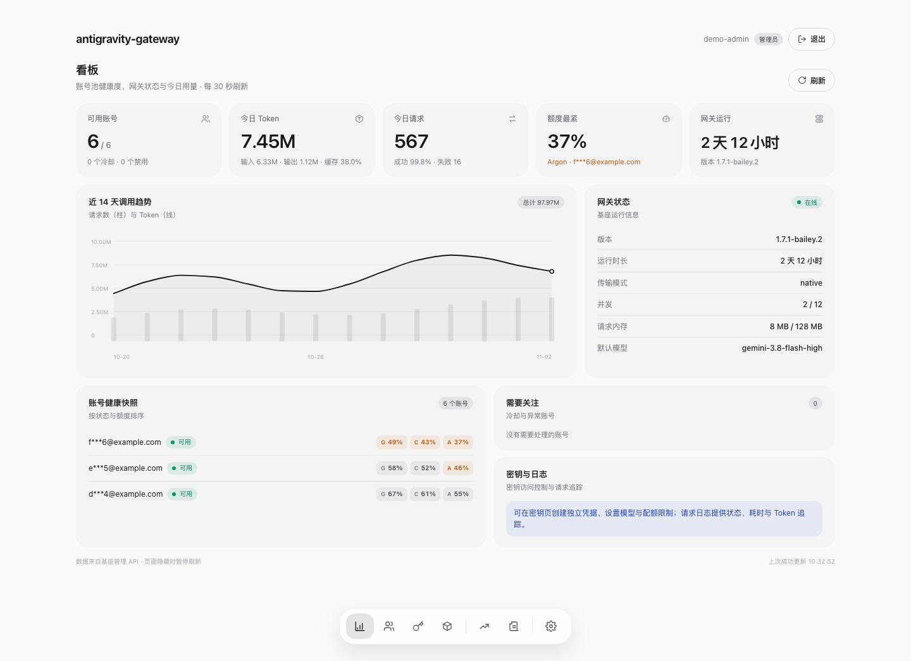
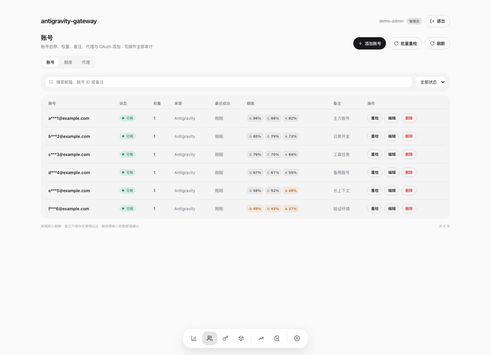
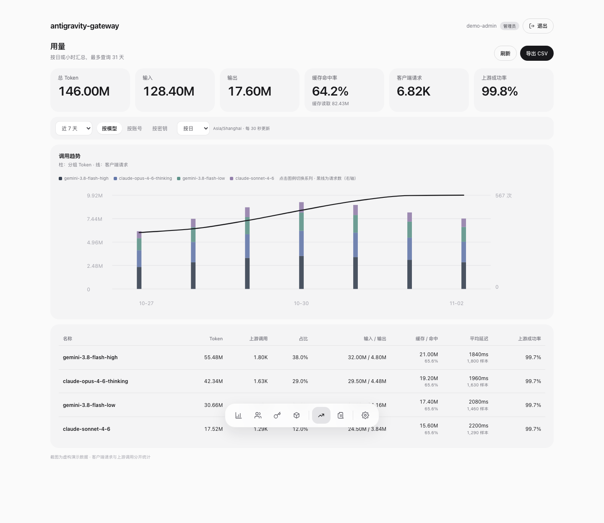
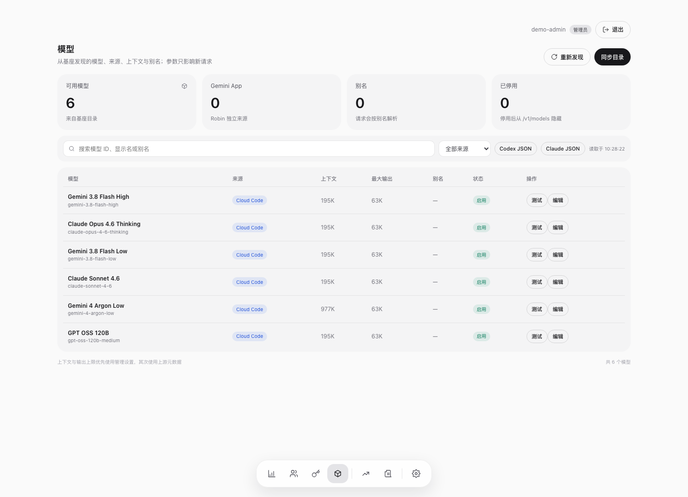
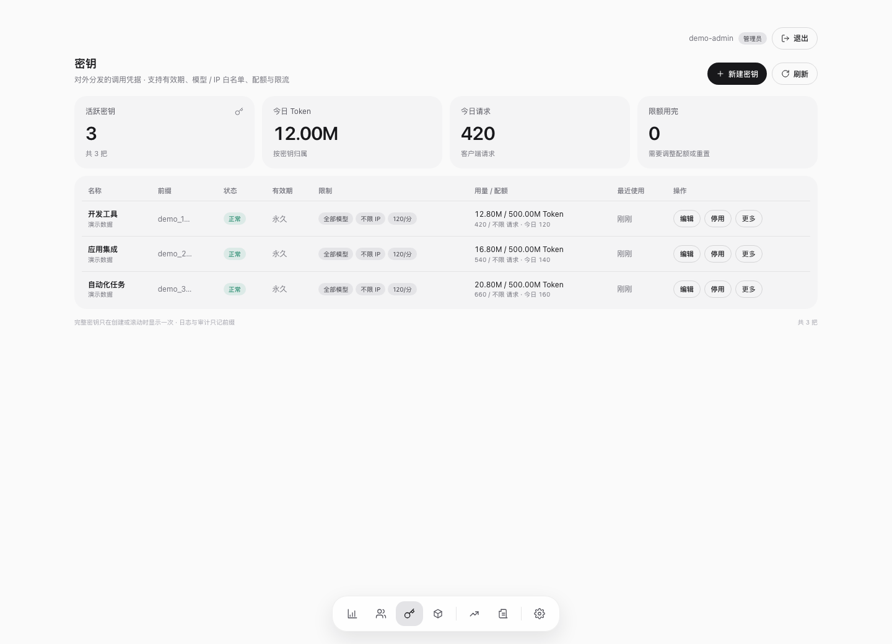
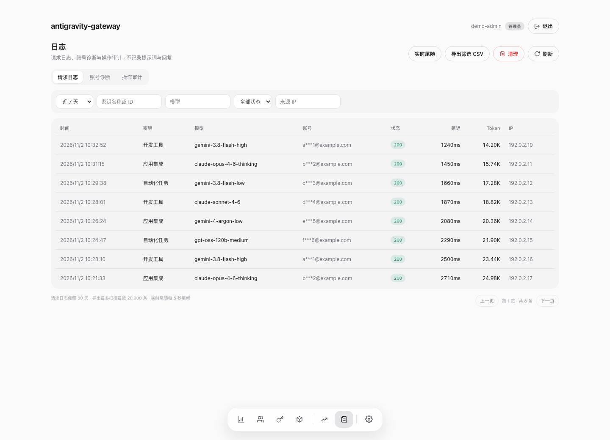
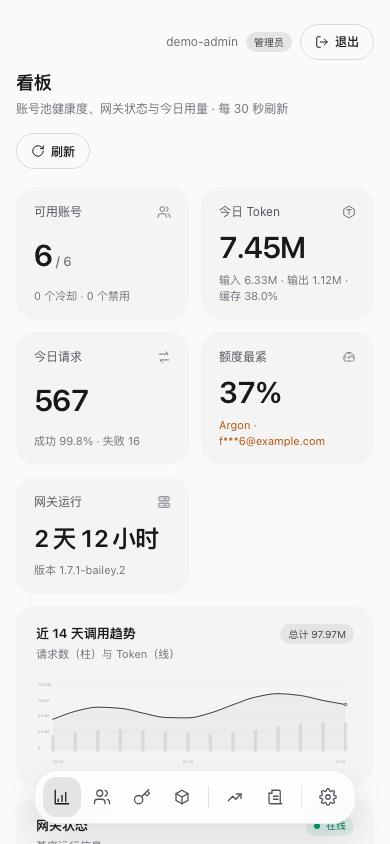
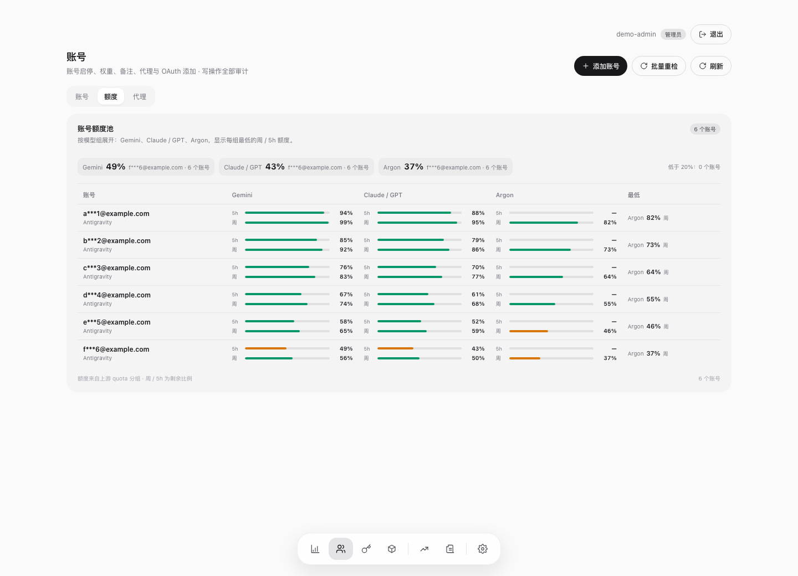
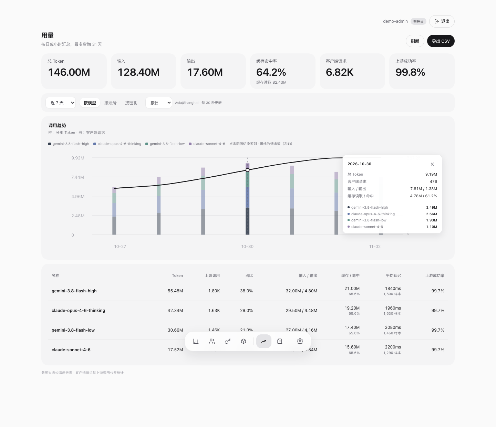

# Antigravity Gateway · Bailey Edition

[](https://github.com/baileyh8/antigravity-gateway/actions/workflows/ci.yml)

维护仓库 / Maintained repository: [baileyh8/antigravity-gateway](https://github.com/baileyh8/antigravity-gateway) · [更新记录 / Changelog](CHANGELOG.md) · [贡献与维护 / Contributing](CONTRIBUTING.md)

> **特别感谢上游作者 LeeFeee 和所有贡献者。** 本项目基于 [LeeFeee/antigravity-gateway](https://github.com/LeeFeee/antigravity-gateway) 继续维护，是原项目的分支方向；代理协议、原始网关能力和历史贡献来自上游。本分支在此基础上发展“代理基座 + 独立管理后台”的架构，补充账号出口隔离、资源控制和运维功能。感谢上游长期开放源码，为这些工作提供基础。保留上游历史、原作者版权与 [MIT 许可](LICENSE)。
>
> **With sincere thanks to LeeFeee and every upstream contributor.** This is a maintained fork of [LeeFeee/antigravity-gateway](https://github.com/LeeFeee/antigravity-gateway), developed in the direction of a proxy core plus a separate management service. The original gateway, protocol work and project history come from upstream. Original attribution, history and the MIT license are preserved.

**1.7.1-bailey.8 · 代理基座与独立后台 / Proxy core + separate admin**

- 基座承担所有代理、账号凭据、API 密钥与请求调度；`manager/` 提供静态前端和独立 Node 管理 API。
- 后台入口 `/admin/`：看板、账号与额度、用量、日志、模型发现/参数、密钥和设置。
- 管理后台安装与架构：[manager/README.md](manager/README.md)。npm 网关包仅包含基座；后台源码随本仓库提供，单独安装和构建。

### 新后台预览 / Admin preview

以下截图展示独立后台界面，使用虚构演示数据，不展示真实账号、密钥或生产用量。Screenshots use synthetic demo data and show the built interface, not production accounts or traffic.



| 账号与分组额度 / Accounts & quota | 用量与缓存命中率 / Usage & cache |
| --- | --- |
|  |  |

| 模型管理 / Models | 密钥管理 / API keys |
| --- | --- |
|  |  |

| 请求日志 / Request logs | 移动端 / Mobile |
| --- | --- |
|  |  |

<details>
<summary>更多截图：分组额度与图表明细 / Quota groups and chart details</summary>




</details>

[中文](#中文) · [English](#english)

## 中文

### 当前源码版本：1.7.1-bailey.8

新会话与换号优先使用对应组剩余额度较多的账号，两窗口一高一低时先照顾较紧的一项；**5h保留10%，周保留5%**。详细比较方式见下文账号调度说明。

会话按“路由会话、账号、模型组”分别计数：默认连续 **20 次成功模型请求**后重新选号，对应组任一有效额度窗口剩余 **≤20%** 时缩短到 **5 次**；固定 **5 小时**期限仍有效，以先达到者为准。工具结果后的再次模型请求也计数，失败、取消和重试不重复计数。并发请求在派发前预留轮次，排队请求在出队时重查；到期优先选择其他支持该模型、有空位且未进入对应窗口保留区的账号。仅原账号可用时允许重新使用它，5h保留10%、周保留5%的规则始终有效。Robin/Windows尚未完成的原生工具任务保留原账号，任务结束后再轮换，任一窗口触及保留线期间暂停继续派发。计数沿用现有最多2000个会话的有界缓存，每个账号池最多一个1秒合并写盘定时器，正常停止时刷盘；突然崩溃可能丢失最后一个合并周期的计数。旧绑定和已记录轮数继续保留；不含计数的旧格式从零计起。

各模型组的有效 **5h 剩余不高于10%**、或**周额度不高于5%** 时，停止向该账号派发对应组的新请求；粘连、排队和兜底选择均遵守这条线，其他组独立使用。全部账号进入保留区时返回 `quota_reserve_reached`（429），额度重置或新读数恢复后重新参与调度。活跃账号每分钟刷新摘要，所选组剩余不高于 20% 时每 15 秒刷新；读数未知时触发有节制的刷新，不伪造剩余额度。在途请求和上游读数延迟可能使最终余额低于对应保留线，无法精确锁定最终余额。

Responses 工具结果中的图片等附件只通过原生媒体传递，不再将 Base64 编码重复放入结果正文。Cloud Code 输入超限明确返回 `context_length_exceeded`；已经开启的 Responses 流通过标准 `response.failed.response.error` 返回原因，保留响应 ID、事件序号和已输出内容。

可在启用 `AGY_MULTI_KEY=1` 并确认各客户端专用密钥有效后，移除服务环境中的 `ANTIGRAVITY_GATEWAY_API_KEY`，禁用旧内置主密钥。无密钥请求仍返回401。后台模型测试使用短期、限单模型的临时密钥，完成或失败后删除，不借用客户端密钥。

调度按请求模型匹配额度组：Gemini、Claude/GPT、Argon 分别使用对应的周/5h额度；组间轮询权重独立，单模型有效容量至多为“支持账号数 × 5”，同时受全局60路限制。组额度缺失时不借用其他组；已过期的重置窗口视为未知。额度快照是调度参考，实际上游限流仍按原冷却机制处理。

旧 `/dashboard` 及其子接口已从基座移除并返回 404。部署方可仅将旧页面 `/dashboard`、`/dashboard/` 在 Nginx 301 到独立后台，其他旧接口保持 404。

当前源码整合上游 `db939d4`（1.7.1 及其后续修复），新增 `manager/` 独立后台，通过回环 `/_admin/v1` 访问基座。两个进程独立运行，代理凭据和密钥保留在基座。上游 `54ae06e`（1.7.2）已评估，OAuth 候选改动尚未合入。

- Cloud Code 原生 Go 传输、会话持久化、客户端上下文压缩及工具映射；包含 Claude Code 2.1.284/2.1.304、Codex 和 Hermes 的定向适配。未知客户端保持兼容路径，不代执行客户端工具。
- 取消或超时不再连锁重试、冷却健康账号；修复容器 PID 复用导致的会话锁死锁、目录锁交接和完整请求排空，保留运行时预算通知的位置以改善前缀缓存。
- Robin 连接丢失后可使用客户端提供的完整工具历史继续；不虚构工具回执或自动恢复已删除账号。
- Windows 新增 `add-gemini-win`，使用本机 Chrome/Edge 登录并保存独立的 `gemini-win-accounts/`。此流程要求 Windows 本机浏览器，不能替代 VPS 看板的 OAuth 添加流程。Windows 通道不支持非视频附件；视频沿用 Cloud Code 路由，原生 usage 仍未知。
- 三种通道共享剩余额度优先、同等额度按权重轮询的调度策略；会话亲和默认 5 小时，可用 `ANTIGRAVITY_AFFINITY_TTL_SECONDS` 调整。保留每账号代理、每账号5路/全局60路执行、独立 4 路媒体与 4 路生图、字节预算和 SSE 背压。

Cloud Code 原生传输按不同代理地址复用独立 helper 进程，并覆盖 helper 的 `NO_PROXY`，防止绕开账号出口；Token 和普通 HTTP 请求仍经同一绑定代理。代理缺失时不回落直连。安装包包含六种平台/架构的原生程序，运行时校验完整性并解压到配置目录，普通安装无需 Go；源码重建使用 `npm run build:native`，要求上游指定的 Go 1.27.2。原生 helper 会增加进程和磁盘占用。当前维护部署完成最小文本请求验证：23 个可用型号成功，另一个 disabled 占位项跳过；这不代表生图、工具或长会话均已验收，也不代表有高并发资源基准。

Windows 终端添加也使用 `ANTIGRAVITY_ROBIN_OAUTH_PROXY_ID` 自动绑定；服务端请求在有效绑定前不会直连。登录浏览器的网络由本机浏览器设置决定。参见 [Windows 通道](docs/windows-native.md) 和 [Robin 通道](docs/robin-provider.md)。上游实验记录只代表上游验证，不作为本维护版部署证明。


Antigravity Gateway 是可在本机或服务器运行的 Anthropic/OpenAI 兼容网关，让 Claude Code、Codex CLI、Trae、DSH、Hermes 及其他兼容客户端调用账号可用的模型。支持导入本地 Antigravity CLI（`agy`）登录态，也支持使用已授权的托管账号池。

本仓库由 Bailey 独立维护，基于 [LeeFeee/antigravity-gateway](https://github.com/LeeFeee/antigravity-gateway)，保留原项目 MIT 许可与历史。`main` 是本仓库的默认安装和维护分支；`codex/bailey-stability` 用于当前稳定性开发。问题和贡献请提交到[本仓库](https://github.com/baileyh8/antigravity-gateway)，本维护线不自动向原项目提交或合并。

默认使用原生 Cloud Code 直连，不经过 `agy` Agent 的包装提示词。客户端选择什么模型，网关就把该模型 ID 原样发送给上游；只有 Claude Code Auto Mode 的分类请求使用独立的快速模型。

> 非 Google 官方项目，仅用于学习、兼容性研究与个人测试。模型权限、额度、地区限制和服务条款均以上游为准。

版本记录见 [GitHub Releases](https://github.com/baileyh8/antigravity-gateway/releases) 与 [CHANGELOG.md](CHANGELOG.md)。历史版本 `1.5.1-bailey.1` 的 Argon 工具调用验收不能替代本版本的完整能力验收。

### 主要功能

- 同时提供 Anthropic Messages、OpenAI Responses 和 Chat Completions 接口。
- 支持 Claude Code、Codex CLI、Trae 和其他兼容客户端。
- 支持前台运行，以及 macOS、Linux、Windows 后台保活和开机自启。
- 支持自动导入本地 agy 账号，也可以输入 `add` 手动添加账号。
- 支持通过独立管理后台添加 Gemini App 账号并调用 `gemini-4-argon`；VPS 部署可在本地浏览器授权，与原 Antigravity 凭据和调度隔离。
- 多账号之间轮询；同一会话保持账号一致，限流、认证或额度异常时自动尝试其他账号。
- 启动界面显示账号状态、历史用量、Token、缓存命中率和最近24小时图表。
- 支持客户端工具调用、SSE、Claude Code Auto Mode 和结构化输出。
- 支持图片生成、参考图编辑，以及图片、视频、音频、PDF 和普通文件理解。
- 支持 OpenAI Images/Files 接口，并让远程客户端先上传文件再在对话中引用。
- 独立管理后台管理账号 HTTP/HTTPS 代理，认证刷新、额度和模型请求使用账号绑定出口。
- 生图与多媒体输入/上传各有独立 4 路并发池，并提供内存预算、异步文件 I/O、SSE 背压及停机排空。

### 使用条件

| 条件 | 说明 |
|---|---|
| Node.js | 20 或更高版本；npm 随 Node.js 一起安装 |
| 账号与授权 | 已登录的本地 `agy`，或含有效刷新凭据与 OAuth 客户端配置的托管账号池 |
| 操作系统 | macOS、Linux 或 Windows，ARM64/x64 |
| 网络 | 当前电脑能够正常访问 Antigravity/Google 上游服务 |

安装器会自动检查 Node.js 版本、操作系统、CPU 架构和临时目录，并由 npm 处理项目依赖。本项目不自动安装 `agy` 或注册账号。默认 `direct` 传输在具备有效托管账号和 OAuth 客户端配置时不依赖服务器安装 `agy`；使用本地登录态发现或显式 `agy` 子进程传输时才需要 CLI。首次授权仍需可用的 OAuth 客户端配置，不能只复制不完整的旧账号文件。

没有 Node.js 时，可使用以下任一方式安装：

macOS（Homebrew）：

```bash
brew install node
```

macOS/Linux（nvm）：

```bash
curl -o- https://raw.githubusercontent.com/nvm-sh/nvm/v0.40.6/install.sh | bash
\. "$HOME/.nvm/nvm.sh"
nvm install 24
```

Windows PowerShell：

```powershell
winget install --exact --id OpenJS.NodeJS.LTS
```

也可以从 [Node.js 官方网站](https://nodejs.org/en/download/) 安装 LTS 版本。

### 安装

一条命令全局安装，不需要克隆仓库，也不需要进入项目目录：

```bash
npm install --global --foreground-scripts --allow-scripts=antigravity-gateway https://github.com/baileyh8/antigravity-gateway/archive/refs/heads/main.tar.gz
```

验证版本：

```bash
antigravity-gateway --version
```

部分 npm 11 版本会提示 `install scripts not yet covered by allowScripts`。如果最后显示 `changed 1 package` 且命令可以运行，说明安装已经完成；该提示不是网关运行错误。

### 启动

前台模式：

```bash
antigravity-gateway
```

默认监听：

```text
Anthropic: http://127.0.0.1:9897
OpenAI:    http://127.0.0.1:9897/v1
API Key:  antigravity-gateway（网关未设置专用 Key 时可使用任意非空内容）
```

关闭终端或按 `Ctrl+C` 会停止前台网关。

后台保活并设置自动启动：

```bash
antigravity-gateway service start
```

管理后台服务：

```bash
antigravity-gateway service status
antigravity-gateway service restart
antigravity-gateway service stop
antigravity-gateway service logs
antigravity-gateway service uninstall
```

重复执行 `service start` 会更新配置并重启现有服务，不会创建重复服务。后台模式没有交互输入框；需要添加账号时，先停止后台服务并以前台模式启动，添加完成后再执行 `service start`。

查看本地 Token 用量统计：

```bash
antigravity-gateway stats
```

该命令直接读取本地统计并输出文本，不启动浏览器或 Web 服务。图形管理界面由独立 agy-manager 的 `/admin/` 提供。

如果 `agy` 不在默认位置：

```bash
antigravity-gateway --agy-path "/absolute/path/to/agy"
```

Windows：

```powershell
antigravity-gateway --agy-path "C:\path\to\agy.exe"
```

### 账号池

网关启动时会检测当前官方 agy 登录账号：

- 账号池中没有该账号：自动保存到账号池并立即参与请求。
- 已存在同一账号：不重复添加，也不使用本地登录态反复覆盖已保存凭据。
- 账号池非空后：请求以账号池凭据为主。

手动添加其他账号：启动前台网关，在 `gateway>` 后输入：

```text
add
```

网关会尝试打开浏览器，同时在终端显示完整授权链接。浏览器没有自动打开时，复制链接到浏览器完成授权。远程服务器无法访问 localhost 回调页时，把浏览器地址栏里的完整回调 URL 粘贴回 `gateway>`。

查看账号池：

```text
acc
```

新会话会在可用账号之间轮询，同一会话尽量保持在同一账号。终端会为每次上游尝试打印实际账号：

```text
[Antigravity Gateway] 路由账号=user@example.com source=managed-account model=gemini-3.8-flash-high attempt=1
```

账号文件保存在：

```text
~/.antigravity-gateway/accounts/
```

账号池凭据以普通 JSON 保存，Token 刷新后会同步更新。请自行管理本机文件和账号使用风险。

#### Gemini App / Argon

**服务运行在 VPS，授权在你自己的浏览器完成。** 无需在 VPS 安装浏览器或 agy-cli，也无需 SSH 转发。

1. 打开已部署的独立管理后台 `/admin/accounts/` 并登录，使用添加账号入口并选择 Gemini App。
2. 在展开的添加区域选择已登记的账号代理，点击「开始添加」。服务端授权与后续模型请求使用这个出口。
3. 打开授权链接，在本地浏览器选择要添加的 Google 账号并完成授权。
4. 浏览器跳到 `127.0.0.1` 后若显示无法连接，复制地址栏里的**完整回调 URL**，粘回看板并提交。这时不需要重做登录。
5. 等待看板保存账号、自动绑定代理并检查能力与额度。确认模型列表包含 `gemini-4-argon` 后，即可用原有网关 API Key 调用。

等待授权时可以刷新看板继续，也可以取消后重新开始；服务重启后需重新发起授权。状态不匹配的回调会被拒绝，重复账号不会被覆盖。授权链接和回调 URL 不要分享给他人。

客户端使用同一个网关地址和 API Key，只需把模型 ID 设为 `gemini-4-argon`。例如，以下 Chat Completions 请求使用占位域名；先将 `GATEWAY_API_KEY` 设置为你自己的网关密钥：

```bash
curl https://gateway.example.com/v1/chat/completions \
  -H "Authorization: Bearer $GATEWAY_API_KEY" \
  -H 'Content-Type: application/json' \
  -d '{"model":"gemini-4-argon","messages":[{"role":"user","content":"Compute 17 times 23."}],"stream":true}'
```

**本维护版验收（2026-10-16）**：已在 VPS 通过本地浏览器完成真实授权，并通过正式 HTTPS 接口验证 Chat Completions 流式回答正常结束、单个 `[DONE]`，以及 Anthropic Messages 工具调用与结果续答。账号代理出口另行核验通过。此轮没有覆盖 Argon 附件、长程并发或所有客户端；不会把上游测试记录当成本维护版的部署验收。

也可在前台终端输入 `add-gemini`，但必须先将 `ANTIGRAVITY_ROBIN_OAUTH_PROXY_ID` 设为已登记代理 ID。凭据持久保存在 `~/.antigravity-gateway/robin-accounts/`，不与 Antigravity 账号混用。请求 `gemini-4-argon` 时进入 Robin 任务模式；仍使用同一网关、看板和 Messages / Chat Completions / Responses 接口，客户端工具仍由客户端执行。普通 Argon 请求不可用时明确报错，不降级到 Antigravity 的其他 Gemini 模型。唯一例外是实际携带视频的请求：Gemini App 依赖本地抽帧而不是可靠的 Argon 原生视频理解，因此网关沿用既有 Cloud Code 多媒体路径和 `ANTIGRAVITY_DEFAULT_MODEL`。现有 Antigravity 账号调度规则不变。

上游记录了文本、客户端工具往返、会话隔离与重启续接、图片/音频/PDF/文本输入和原生额度查询的实测；本维护版的真实验收范围见上文。视频请求的回退路由已有回归覆盖；真实视频理解由原有 Cloud Code 路径负责。遇到尚未接受 Gemini 服务条款的账号时，网关返回脱敏的中文处理提示，不向 API 调用方暴露账号邮箱或 ID；不会自动切换账号。网关不从实验接口推导或提供 Gemini App 中不存在的思考档位，并忽略客户端的 reasoning 控制，不向 Argon 请求写入隐藏思考字段。原生 token 用量等仍未验证完成。授权、部署、兼容与验证边界见 [Robin Provider 开发说明](docs/robin-provider.md)。

### 前台终端命令

| 命令 | 作用 |
|---|---|
| `add` | 添加 Antigravity 账号 |
| `add-gemini` | 独立授权 Gemini App 账号（终端备用方式） |
| `acc` | 查看账号池和账号状态 |
| `models` | 查看当前发现的模型 |
| `status` | 重新显示网关和统计状态 |
| `usage` | 查看实时详细用量 |
| `stats` | 在默认浏览器查看本地用量统计 |
| `reload` | 重新加载账号与额度信息 |
| `config` | 查看客户端连接配置 |
| `logs` | 查看日志说明或位置 |
| `clear` | 清理当前终端显示 |
| `version` | 查看网关版本 |
| `help` | 查看命令帮助 |
| `quit` | 保存状态并关闭网关 |

额度查询在后台异步进行。启动画面中的 `1/1 额度可用` 表示当时成功取得了一个有效额度快照，并不代表其他账号一定没有额度；等待几秒后输入 `status` 可重新显示当前结果。

### 接入 Claude Code

在 `~/.claude/settings.json` 的 `env` 中配置：

```json
{
  "env": {
    "ANTHROPIC_BASE_URL": "http://127.0.0.1:9897",
    "ANTHROPIC_AUTH_TOKEN": "antigravity-gateway",
    "ANTHROPIC_DEFAULT_OPUS_MODEL": "claude-opus-4-6-thinking",
    "ANTHROPIC_DEFAULT_SONNET_MODEL": "claude-sonnet-4-6",
    "ANTHROPIC_DEFAULT_HAIKU_MODEL": "gemini-3.8-flash-low",
    "CLAUDE_CODE_MAX_CONTEXT_TOKENS": "1048576"
  }
}
```

启动 Claude Code：

```bash
claude --model 'gemini-3.8-flash-high[1m]'
```

网关会生成包含当前真实模型的 Claude Code `modelPicker` 文件：

macOS/Linux：

```bash
claude --settings "$(antigravity-gateway --claude-config-path)"
```

Windows PowerShell：

```powershell
claude --settings (antigravity-gateway --claude-config-path)
```

也可以执行下面的命令，把输出的 `modelPicker` 合并进自己的 `~/.claude/settings.json`：

```bash
antigravity-gateway --claude-config
```

注意：

- 使用本地网关时，不要同时启用 `CLAUDE_CODE_USE_BEDROCK`、`CLAUDE_CODE_USE_VERTEX` 或 `CLAUDE_CODE_USE_FOUNDRY`。
- Gemini 3.7/3.8 Flash 的上游目录当前返回 1,048,576 输入 Token；`[1m]` 或 `CLAUDE_CODE_MAX_CONTEXT_TOKENS=1048576` 用于告诉 Claude Code 使用真实窗口。
- 正常请求使用客户端指定的模型。Auto Mode 分类请求单独使用快速模型，不改变主会话模型。

### 接入 Codex CLI

先取得动态模型目录路径：

```bash
antigravity-gateway --codex-catalog-path
```

在 `~/.codex/config.toml` 中配置：

```toml
model = "gemini-3.8-flash-high"
model_provider = "antigravity"
model_catalog_json = "/ABSOLUTE/PATH/.antigravity-gateway/codex-models.json"

[model_providers.antigravity]
name = "Antigravity Gateway"
base_url = "http://127.0.0.1:9897/v1"
env_key = "ANTIGRAVITY_GATEWAY_API_KEY"
wire_api = "responses"
request_max_retries = 0
stream_max_retries = 0
```

Windows 路径建议使用 TOML 单引号：

```toml
model_catalog_json = 'C:\Users\YOUR_NAME\.antigravity-gateway\codex-models.json'
```

启动前设置 Key：

macOS/Linux：

```bash
export ANTIGRAVITY_GATEWAY_API_KEY=antigravity-gateway
codex
```

Windows PowerShell：

```powershell
$env:ANTIGRAVITY_GATEWAY_API_KEY = "antigravity-gateway"
codex
```

### 接入 Trae 或其他客户端

根据客户端支持的协议填写：

| API 格式 | Base URL | API Key | 模型 |
|---|---|---|---|
| Anthropic Messages | `http://127.0.0.1:9897` | `antigravity-gateway` | 从模型目录选择 |
| OpenAI Responses/Chat | `http://127.0.0.1:9897/v1` | `antigravity-gateway` | 从模型目录选择 |

查询模型：

```bash
antigravity-gateway --models
curl http://127.0.0.1:9897/v1/models
```

模型取决于账号、套餐、地区和 Antigravity CLI 版本。模型目录只用于展示和诊断，不会阻止客户端把其他模型 ID 发给上游。

### 图片生成与多媒体理解

普通对话不依赖关键词判断。网关把文本和附件一并交给客户端指定的 Gemini 模型：模型认为附件只是资料时直接理解并回答；只有用户明确要求产出新图片或编辑参考图时，模型才会调用内置的原生生图工具。客户端自己的工具名、`tool_choice` 和工具执行流程不会被替换。

原生生图直接使用 agy 同款的 Antigravity 私有图片请求和账号池凭据，不会为每次请求启动本机 agy。新版本通过 `add` 授权的账号会同时保存后续刷新所需的 OAuth 客户端元数据；把完整账号 JSON 复制到服务器账号池后，即使服务器没有安装 agy，该账号也能刷新并参与对话和生图。旧版已保存但不含这些字段的账号仍按原有方式从本机 agy 安装中发现刷新配置。

OpenAI 标准文生图：

```bash
curl http://127.0.0.1:9897/v1/images/generations \
  -H 'Content-Type: application/json' \
  -d '{"prompt":"白色背景中央的黑色六边形","size":"1024x1024","response_format":"url"}'
```

参考图编辑，最多 3 张参考图：

```bash
curl http://127.0.0.1:9897/v1/images/edits \
  -F 'image=@reference.png' \
  -F 'prompt=只把主体颜色改为紫色，其他内容不变' \
  -F 'response_format=url'
```

远程服务器或不能直接传本地路径的客户端，可以先上传文件：

```bash
curl http://127.0.0.1:9897/v1/files \
  -F 'file=@recording.mp4;type=video/mp4' \
  -F 'purpose=assistants'
```

返回的 `file_...` 可放进 Anthropic `source.file_id`、Chat Completions 的 `file_id`/`input_image`/`input_video`，或 Responses 的 `input_file`/`input_image`/`input_video`。协议转换器也接受 Base64/Data URL、HTTP(S) URL 和网关本机绝对路径；生成图片的 URL 可以直接作为后续参考图再次使用。上传与生成文件保存在 `~/.antigravity-gateway/media/`。

生图响应会同时提供普通文本回执、Markdown、可访问 URL、网关主机上的绝对路径，以及各协议中的 `artifacts` 结构化元数据；不识别扩展字段的客户端仍可从正文取得交付地址。文件内容接口同时支持 `GET` 和 `HEAD`。

如果 Agent 本身不会把本地视频转换成多媒体请求，可以使用随包附带的 `skills/antigravity-video-understanding`。该 Skill 的 Python 脚本会通过现有 Files API 上传本地视频，再以原生 `input_video` 调用 Chat Completions；本地或远程网关均使用同一流程：

```bash
python3 skills/antigravity-video-understanding/scripts/analyze_video.py \
  "/absolute/path/recording.mp4" \
  --prompt "分析这段视频并回答我的问题"
```

网关分别管理客户端身份、独立对话和账号黏性：同一对话及其工具调用优先使用同一账号；子 Agent 使用独立会话状态，但通过父会话继承账号黏性。软黏性映射会在本地保存固定 5 小时（可通过 `ANTIGRAVITY_AFFINITY_TTL_SECONDS` 调整），网关重启后仍会优先恢复当前窗口内的账号；窗口内且未达到20轮（组剩余≤20%时5轮）的后续请求检查本地可用状态和缓存额度保留线，不重新进行额度排序。轮数或窗口到期、账号进入额度保留区、网络异常、凭据失效、访问受限或 Google 要求安全核验时会重新按请求所属模型组的剩余额度重新选择，同等额度的账号按权重轮询。认证和账号风控会把账号标记为异常并停止继续尝试；重新授权导致凭据变化时自动恢复，也可以在看板中点击“重新检测”，以不生成内容、不消耗模型 Token 的轻量鉴权确认核验结果。网络瞬态故障仍由直连传输重试，失败后只进入短暂冷却。

首次选号、到轮换期限或故障转移时，只比较请求所属的 Gemini、Claude/GPT 或 Argon 额度组。5h保留10%，周保留5%；任一有效窗口到线即排除。对每个窗口计算可用余量 `(剩余比例 - 保留比例) / (1 - 保留比例)`，先比较两项中较小的余量，再比较另一项，余量越大越优先。例如周90%/5h15%与周70%/5h80%，优先后者。两窗口读数完整的账号优先于仅有部分读数，已知部分读数优先于全未知；仅有周额度的Argon按该周读数比较，不虚构5h余额。同等余量的账号按配置权重轮询，原重置时间压力不再增加优先级。各组状态独立，缺失的组不借用其他组。未到20/5轮期限的健康粘连继续保留；绑定账号忙、到期或不合格时重新选择可运行账号。

选号只读取内存中的真实上游额度快照，不等待联网查询，也不根据 Token 用量推算余额。当前组已知剩余额度优先，未知读数随后；已知5h剩余≤10%或周剩余≤5%的账号不再作为兜底。快照过期、重置已到或字段缺失时补刷新；已知低额度在其窗口重置或更新读数前继续保护；没有可比较余额的账号退回按权重轮询。后台保留约 30 分钟一次的完整刷新；缺失/失效快照及实际额度失败只补查相关账号的额度汇总，普通补刷新每账号至少间隔5分钟；活跃账号最短间隔1分钟，当前组剩余不高于20%时缩短为15秒。重复请求合并，最多同时刷新两个账号。新增账号、凭据变化及重新检测成功会触发该账号的完整刷新。额度汇总单独记录观测时间，套餐或模型目录查询成功不会把旧额度标记为最新。

支持客户端显式发送 `x-client-id`/`x-agent-id`、`x-session-id`/`x-conversation-id`、`x-parent-session-id` 和 `x-routing-affinity-id`；未提供时继续兼容现有 Claude、Codex、OpenAI 和 Anthropic 客户端字段。所有原始标识仅用于本地路由，提交上游的会话值是不可逆哈希，不会写入模型提示词。日志中的 request、client、session 和 affinity 短标识可用于区分并发链路。

### 用量和额度

启动界面显示：

- 账号池可用状态和已取得的额度快照。
- 历史请求数、上游调用数、输入/输出 Token、缓存 Token 与命中率。
- 最近24小时每小时用量图。

协议用量字段与缓存兼容性：

- **Anthropic 协议**：`input_tokens` 自动扣除缓存读取量（`prompt - cache_read`），避免客户端双重计费；缓存读取量通过 `cache_read_input_tokens` 上报。
- **OpenAI 协议（Chat Completions）**：`prompt_tokens` 保持包含缓存的前缀总数，并通过标准 `prompt_tokens_details.cached_tokens` 上报缓存读取量，通过 `completion_tokens_details.reasoning_tokens` 上报思考/推理 Token，完美兼容 DeepSeek Harness (DSH)、Cursor、OpenRouter 等下游客户端的缓存命中与统计展示。

输入 `usage` 查看实时明细，输入 `status` 刷新展示。用量每5分钟保存一次，24小时图表每小时更新，历史总量展示每24小时更新。完整额度快照约每30分钟刷新，活跃账号会按上述1分钟/15秒间隔补查摘要；上游实时返回始终是最终依据。

另开终端可通过下面的命令输出本地用量摘要：

```bash
antigravity-gateway stats
```

图形看板、账号/密钥/模型管理和日志由独立 agy-manager 提供。基座保留用量存储、额度和 `/_admin/v1` 回环接口，不再加载 HTML、截图工具或旧面板管理路由。

```text
~/.antigravity-gateway/state/account-pool.json
~/.antigravity-gateway/state/quota.json
~/.antigravity-gateway/usage/usage-state.json
```

`account-pool.json` 只保存账号 ID、不可逆会话路由标识、被主动删除身份的不可逆哈希、时间和账号健康状态，不保存提示词、模型回复或账号 Token；用量统计也只保存数字。

### 账号独立代理

在独立管理后台 `/admin/accounts/` 的「代理管理」中新增 HTTP/HTTPS 代理，然后为账号选择出口并点击「应用」。支持编辑、删除及 Google HTTPS 连通性检测；检测结果仅代表当次网络探测，不代表账号授权或模型额度正常。代理节点由外部代理软件或供应商提供，Gateway 不包含订阅管理或保证静态公网 IP。

- 已绑定账号的聊天、模型列表、图片请求、OAuth Token 刷新及额度查询使用同一个代理。代理失败会返回错误，不回退进程默认代理或直连；账号池仍可按原策略尝试其他账号。
- 未绑定账号（包括新导入账号）继续使用原来的进程网络配置。解除绑定会恢复该行为。首次 OAuth 登录尚无账号绑定，仍走原进程网络。
- 绑定保存在配置目录的 `proxies.json`（0600），与账号 Token 文件分离，刷新 Token 不会覆盖绑定。配置损坏时拒绝启动；绑定指向不存在的代理时该账号请求失败。
- 修改立即作用于后续网络请求，无需重启。仍有响应体传输的代理不能编辑或解除绑定；已绑定代理不能删除。代理认证 URL 不在看板 API 中回显，也不进入分享图片；编辑 URL 留空保留旧值，输入新 URL 则完整替换。
- 本功能用于 `direct` 多账号传输；`agy` CLI 传输和未管理的本地登录仍使用原网络设置。每日巡检和节点替换由外部运维任务负责，本功能不自动轮换节点。

管理接口只接受回环连接和 `X-Agy-Admin-Token`。独立管理 API 负责会话、CSRF、Origin 和审计，不能将 `/_admin` 暴露到公网。请求体使用 JSON：

| 方法 | 路径 | 用途 |
| --- | --- | --- |
| GET | `/_admin/v1/proxies` | 脱敏代理列表、绑定、在途网络请求数及上次检测 |
| POST | `/_admin/v1/proxies` | 新增或更新 `{id?, name, url?}`（支持 URL 用户名/密码） |
| DELETE | `/_admin/v1/proxies/:id` | 删除未绑定、空闲代理 |
| POST | `/_admin/v1/proxies/:id/check` | 检测固定 Google HTTPS 目标 |
| PUT | `/_admin/v1/accounts/:id/proxy` | 绑定 `{proxyId}`；`null` 解除绑定 |

请通过管理接口修改运行中的配置；直接编辑 `proxies.json` 后需要重启 Gateway。代理地址只支持 HTTP/HTTPS CONNECT，不支持 SOCKS。

### 并发与资源保护

| 请求类别 | 默认并发 | 计数方式 |
| --- | --- | --- |
| 模型请求 | 12（direct） | 文本、工具与多媒体输入共用；显式 agy 子进程传输默认为 4 |
| 生图、图片编辑 | 4 | Images API 与对话内部原生生图工具共用独立池 |
| 多媒体输入、文件上传 | 4 | 图片、视频、音频、PDF/文件输入与 Files 上传合计，不是每类各 4 路 |

生图池与输入/上传池可同时运行 4＋4；含媒体输入并触发生图的对话在生图阶段同时占用两个池。单次 Images 请求的 `n` 张图片仍顺序生成。每账号所有模型共享5路推理，全局最多60路；共享队列最多120个请求，累计等待30秒。原绑定账号满载时，可在请求发出前切换到其他健康且支持当前模型的空闲账号。尚未完成的Robin工具任务保留原账号。并发数是配置上限，不保证上游承载能力。

请求正文共享 384 MiB 估算预算；解析后的媒体另有 512 MiB 预算，按二进制大小的四倍预留缓冲、Base64 与协议副本。超限返回 503，即使并发池仍有空位；排队满返回 429。预算不是进程 RSS 硬限制。Responses 历史缓存默认 64 MiB，SSE 缓冲默认每客户端 8 MiB；媒体磁盘限额默认关闭，可显式设置，超限拒绝新增而不删除历史文件。停机先排空请求，再保存用量。

环境变量与完整机制见[资源配置表](#resource-limits-and-concurrency)。回环接口 `/_admin/v1/overview` 的 `concurrency` 字段提供各池 active/limit/queued 与内存预算占用，不额外暴露账号凭据。

2026-10-09 验证：Node 24 环境下本机和 Linux 候选各 252 项测试通过；真实 HTTPS 四路上传、四路生图与四路媒体输入（两张 PNG、两个一秒 MP4）通过，两个池同时达到 4 路。此结果不代表大文件持续压测或所有客户端 UI 均已验收。

### 更新与卸载

更新：

```bash
npm install --global --foreground-scripts --allow-scripts=antigravity-gateway https://github.com/baileyh8/antigravity-gateway/archive/refs/heads/main.tar.gz
```

更新后必须重启正在运行的网关。前台模式按 `Ctrl+C` 后重新运行；后台模式执行：

```bash
antigravity-gateway service start
```

卸载：

```bash
antigravity-gateway service uninstall
npm uninstall --global antigravity-gateway
```

### 常见问题

#### `401 本地 agy 登录态刷新失败`

先在官方 `agy` 中重新登录并完成一次正常对话，然后重启网关。输入 `acc` 检查账号池状态；若看板仍标记异常，可点击该账号的“重新检测”确认新凭据或安全核验已经生效。

#### `429 Resource has been exhausted`

通常表示当前账号或模型额度受限。网关会尝试其他可用账号；如果所有账号都受限，请等待额度恢复或切换模型。

#### `EADDRINUSE 127.0.0.1:9897`

已有网关占用端口。关闭旧进程，或使用其他端口：

```bash
antigravity-gateway --port 9898
```

客户端 Base URL 也必须改成新端口。

#### Claude Code 请求没有出现在网关日志

检查 `ANTHROPIC_BASE_URL`，并移除 Bedrock、Vertex、Foundry 等会覆盖本地 Base URL 的 provider 开关。系统代理环境下可设置：

```bash
export NO_PROXY=127.0.0.1,localhost
```

#### 鉴权与休眠恢复诊断日志

网关会把账号隔离、手动重新检测、Token 刷新阶段、上游鉴权探测结果，以及疑似休眠或挂起造成的运行时间断层写入 `~/.antigravity-gateway/logs/auth-diagnostics.jsonl`。每行都是带 ISO 时间的独立 JSON，便于按事件还原链路；文件达到约 5 MB 后保留一份 `.1` 轮转副本。日志只记录账号掩码、状态、耗时、HTTP 状态和脱敏错误，不记录 access token、refresh token、client secret、提示词或模型回答。

```bash
tail -f ~/.antigravity-gateway/logs/auth-diagnostics.jsonl
```

#### 启动时只发现少量模型

模型探测可能暂时失败或账号目录尚未刷新。输入 `models`、`reload`，或使用 `antigravity-gateway --models` 再次查询。客户端明确指定的模型仍会原样发给上游。

### 常用配置

| 环境变量 | 默认值 | 作用 |
|---|---|---|
| `ANTIGRAVITY_GATEWAY_HOST` | `127.0.0.1` | 网关监听地址 |
| `ANTIGRAVITY_GATEWAY_PORT` | `9897` | 网关监听端口 |
| `ANTIGRAVITY_GATEWAY_API_KEY` | 空 | 自定义网关 Key；非本机监听时必须设置 |
| `ANTIGRAVITY_CLI_PATH` | 自动查找 `agy` | 指定 agy 路径 |
| `ANTIGRAVITY_LOCAL_AUTH_FILE` | 自动读取本地登录态 | 指定本地 agy 凭据文件 |
| `ANTIGRAVITY_GATEWAY_CONFIG_DIR` | `~/.antigravity-gateway` | 账号、额度、用量和客户端配置目录 |
| `ANTIGRAVITY_DEFAULT_MODEL` | `gemini-3.8-flash-high` | 请求未提供模型时使用 |
| `ANTIGRAVITY_FAST_MODEL` | 自动选择 | Claude Code Auto Mode 分类请求使用 |
| `ANTIGRAVITY_MODEL_ALIASES` | `{}` | 用户主动设置的精确模型映射 |
| `ANTIGRAVITY_DIRECT_MODEL_DISCOVERY_TIMEOUT_MS` | `8000` | 模型目录探测超时，单位毫秒 |
| `ANTIGRAVITY_GATEWAY_TIMEOUT_MS` | `300000` | 单次请求总超时，单位毫秒 |
| `ANTIGRAVITY_GATEWAY_MAX_CONCURRENCY` | `60`（`agy` 模式为 `4`） | 最大并发执行数 |
| `ANTIGRAVITY_GATEWAY_MAX_QUEUE` | `120` | 所有准入阶段共享的排队请求上限 |
| `ANTIGRAVITY_GATEWAY_ACCOUNT_CONCURRENCY` | `5` | 每账号所有模型共享的推理并发上限 |
| `ANTIGRAVITY_GATEWAY_QUEUE_TIMEOUT_MS` | `30000` | 每个请求跨准入阶段的累计排队期限；执行时间另受总超时限制 |
| `ANTIGRAVITY_AFFINITY_TTL_SECONDS` | `18000` | 账号软黏性的固定窗口，单位秒；与20/5轮限制同时生效，成功请求不会续期 |
| `ANTIGRAVITY_GATEWAY_CORS_ORIGIN` | 空 | 允许访问本地网关的浏览器 Origin |
| `ANTIGRAVITY_GATEWAY_DEBUG` | 空 | 设置为 `1` 输出更多诊断信息 |
| `ANTIGRAVITY_GATEWAY_TOOL_NARRATION` | 空（关闭） | 设置为 `1` 后，要求模型按工作阶段说明进度；阶段内不逐工具解说，阶段切换时简短交代 |
| `ANTIGRAVITY_IMAGE_MODEL` | `gemini-3.1-flash-image` | 原生图片请求使用的 Antigravity 图片模型 |
| `ANTIGRAVITY_GATEWAY_MEDIA_LIMIT` | `100663296` | 单个多媒体文件内存/解析上限，单位字节 |
| `ANTIGRAVITY_GATEWAY_TOTAL_MEDIA_LIMIT` | `201326592` | 单次对话解析的多媒体总上限，单位字节 |

非必要情况下不建议手动设置 access token、refresh token、project ID 或上游地址。普通用户使用本地 agy 登录态和账号池即可。

#### 工具调用前的进度说明（`ANTIGRAVITY_GATEWAY_TOOL_NARRATION`）

Agent 客户端只渲染模型写出来的内容。有些模型（例如 Cloud Code 背后的 Gemini）在默认情况下会沉默地直接发起工具调用，于是界面从提问到整轮结束之间一直是静止的，看起来像"卡住了"；另一些模型（例如 DeepSeek）则会主动补一句过渡说明。

把这个开关设为 `1` 后，网关会在上游系统指令末尾追加一段约定，让模型按**工作阶段**报告进度，而不是逐工具播报，也不是只在整个任务开头和结尾说话：

- 开始时说明当前阶段要达成什么；阶段内的并行调用与跨轮依赖调用不重复解说。
- 调查、实现（如果用户要求）、验证可以属于同一总目标的不同阶段。切换阶段前，用一句话交代已有发现与下一步，例如“两个输出路径都复用了完整用量对象，接下来运行测试验证”。计划工具的状态更新不能代替这句正文。
- 长阶段内，如果有实质发现缩小了排查范围，或异常结果改变了方案，可简短更新；不按固定工具次数插话，不逐个播报普通重试，也不虚构时间或进度。
- 简单的多文件查找无需强拆阶段；最终回答不受进度句的 30 词限制。

这是提示词约定，不保证每次模型输出都遵守，也不会由网关生成或删减模型正文。

- 默认关闭，行为与之前完全一致。
- 只作用于**带工具**的请求；没有工具就没有需要说明的动作。
- **不会**影响 Claude Code Auto mode 分类请求（必须只返回一段 XML）和结构化输出请求（必须只返回一个 JSON 值）——给这两类请求追加正文会破坏客户端契约。
- 仅 `direct` 传输支持；`agy` CLI 回退路径要求工具调用信封前后不能有正文。

```sh
export ANTIGRAVITY_GATEWAY_TOOL_NARRATION=1
antigravity-gateway service restart
```

当前是否生效可以从健康接口读取：`curl -s http://127.0.0.1:9897/ | grep -o '"tool_narration":[a-z]*'`。

跨设备查看看板时，需要同时把监听地址改为非回环地址并设置 API Key。例如只允许局域网 `192.168.1.0/24`：

```bash
export ANTIGRAVITY_GATEWAY_HOST=0.0.0.0
export ANTIGRAVITY_GATEWAY_API_KEY=请设置自己的密钥
antigravity-gateway
```

看板本身不校验 API Key，白名单来源可以看到账号邮箱、额度和用量；不建议在公网环境中使用 `*`。来源按真实 TCP 对端地址判断，不信任 `X-Forwarded-For`。使用后台模式时重新执行 `antigravity-gateway service start`，即可保存配置并重启服务。

### 接口

```text
GET  /
GET  /v1/models
POST /v1/files
GET  /v1/files/:id
GET  /v1/files/:id/content
DELETE /v1/files/:id
POST /v1/images/generations
POST /v1/images/edits
POST /v1/messages
POST /v1/messages/count_tokens
POST /v1/responses
POST /v1/chat/completions
```

### 工作原理

客户端请求先进入本地兼容接口，网关完成 Anthropic/OpenAI 与 Cloud Code 之间的格式转换，再使用本地账号池凭据请求上游，最后把结果转换回客户端协议。普通客户端工具仍由 Claude Code、Codex 等客户端执行；只有网关私有的原生生图工具由网关拦截，并直接调用 Antigravity 图片接口。

### 已知限制

- 直连使用的是非公开 Cloud Code 内部接口，上游升级后可能需要同步适配。
- 可用模型和额度取决于账号；本项目不会绕过上游限制。
- 工具调用、Auto Mode 和结构化输出请求可能需要先完整校验，再向客户端返回。
- 私有生图和多媒体协议并非公开稳定接口，上游格式或权限发生变化时可能需要同步适配。
- 本地账号文件是普通 JSON，由使用者自行保管。

### License

MIT，见 [LICENSE](LICENSE)。

---

## English

### Current source version: 1.7.1-bailey.8

New sessions and rebalancing prefer larger remaining quota in the requested group, comparing the tighter window first. **Reserve 10% of five-hour quota and 5% of weekly quota.**

Affinity counts successful model requests separately per routing session, account and quota group. Rebalance after **20 successes**, or **five** when any valid window of the selected group has **20% or less** remaining; the fixed **five-hour** deadline still applies, whichever comes first. Model requests following tool results count too; failures, cancellations and retries do not add duplicate turns. Concurrent dispatches reserve turn budget, and queued requests recheck it at admission. Prefer another compatible, idle account above the applicable window reserve; reuse the current account only when no alternative can run. Unfinished Robin/Windows native tool tasks keep their owner until complete, while the 10% five-hour / 5% weekly reserves still stop further dispatch. The existing 2,000-session bound remains. At most one one-second batched-save timer per pool persists counters and flushes on graceful stop; a crash can lose the last save interval. Existing bindings and recorded counters survive upgrades; only records without counters begin at zero.

An account stops receiving new work for a model group when a valid **five-hour window has 10% or less** remaining, or a **weekly window has 5% or less** remaining. Affinity, queued dispatch and fallback cannot bypass the reserve; other groups remain independent. A fully protected pool returns `quota_reserve_reached` (429), and becomes eligible again after the relevant reset or an improved reading. Active-account summaries refresh every minute, or every 15 seconds at 20% or less remaining in the selected group. Unknown readings trigger throttled refreshes rather than fabricated balances. In-flight requests and delayed upstream telemetry prevent an exact final-balance guarantee at either reserve.

Responses tool-output attachments travel only as native media, without duplicating Base64 in the accompanying text. Cloud Code input overflows report `context_length_exceeded`; open Responses streams return the reason in `response.failed.response.error`, retaining the response ID, event sequence and delivered partial output.

After enabling `AGY_MULTI_KEY=1` and migrating clients to dedicated keys, remove `ANTIGRAVITY_GATEWAY_API_KEY` from the service environment to retire the legacy master key. Missing credentials still return 401. Admin model probes use short-lived, model-scoped keys with cleanup on success or failure instead of depending on a client key.

Quota selection follows the requested model: Gemini, Claude/GPT and Argon use separate weekly/5h groups and independent weighted rotation. Five inference slots are shared across each account’s models, capped at 60 executions globally. The model-specific ceiling is five times its eligible account count, bounded by the global cap. A shared 120-request queue has a cumulative 30-second wait budget; oldest runnable work can pass a blocked model. Busy affinity accounts may switch before dispatch; unfinished Robin tool tasks retain ownership. Initial queue rejection returns HTTP 429 with Retry-After before opening SSE. These are configured limits, not measured upstream capacity or a memory guarantee.

The built-in `/dashboard` page and all subroutes return 404. Deployments may keep an Nginx 301 for the page URLs only, pointing to the separate admin service. Legacy mutation APIs must remain retired.

This source integrates upstream `db939d4` (1.7.1 plus subsequent fixes). The separate admin source is in `manager/`, with static pages and a Node management API calling the loopback `/_admin/v1` contract. Proxy credentials and API keys remain in the core. Upstream `54ae06e` (1.7.2) was reviewed; its OAuth candidates are not included.

- Native Go Cloud Code transport, persisted sessions, compaction and targeted Claude Code 2.1.284/2.1.304, Codex and Hermes tool adapters. Unknown clients retain compatibility behavior; tools execute on clients.
- Cancellation/timeout no longer cascades across healthy accounts. Includes container PID-reuse lease fixes, directory ownership and transaction draining, and position-preserving runtime budget notices for prefix caching.
- Robin can forward complete client-supplied tool history after connection loss, without inventing receipts or restoring deleted accounts.
- `add-gemini-win` adds local Windows Chrome/Edge login with separate `gemini-win-accounts/` credentials. It requires a Windows browser and does not replace VPS dashboard OAuth. Non-video attachments are unsupported on this channel; video retains Cloud Code routing and native usage remains unknown.
- Shared remaining-quota priority with weighted ties; affinity defaults to five hours (`ANTIGRAVITY_AFFINITY_TTL_SECONDS`). Per-account proxies, five executions per account and 60 globally, separate four-way media and image pools, byte budgets and SSE backpressure remain.

Native helpers are reused per proxy endpoint with proxy bypass variables cleared. Token and ordinary HTTP requests use the same account proxy; invalid bindings never fall back to direct access. Packages include verified native binaries for six platform/architecture combinations; normal installs need no Go toolchain. `npm run build:native` requires upstream's Go 1.27.2. Helpers add process and disk overhead. Minimal text requests succeeded for 23 available models on the maintained deployment; a disabled placeholder was skipped. This is not image, tool, long-session or high-concurrency resource acceptance.

Windows terminal onboarding also binds `ANTIGRAVITY_ROBIN_OAUTH_PROXY_ID`; server requests fail closed until a valid binding exists. Login browser routing follows local browser settings. See [Windows channel](docs/windows-native.md) and [Robin channel](docs/robin-provider.md). Upstream experiment reports are not deployment evidence for this distribution.


Antigravity Gateway is an Anthropic/OpenAI-compatible gateway for local or server deployment. Claude Code, Codex CLI, Trae, DSH, Hermes and other compatible clients can use available account models through imported Antigravity CLI (`agy`) credentials or an authorized managed account pool.

This repository is independently maintained by Bailey, based on [LeeFeee/antigravity-gateway](https://github.com/LeeFeee/antigravity-gateway), with the original MIT license and history preserved. `main` is this repository’s default installation and maintenance branch; `codex/bailey-stability` is the current stability development branch. Submit issues and contributions to [this repository](https://github.com/baileyh8/antigravity-gateway). Changes on this line are not automatically submitted or merged upstream.

The default `direct` transport calls Cloud Code without the agy Agent wrapper prompt. Normal requests preserve the exact model ID selected by the client. Only detected Claude Code Auto Mode classifier requests use a separate fast model.

> Unofficial and intended for learning, compatibility research, and personal testing. Upstream plans, quotas, regional restrictions, and terms still apply.

See [GitHub Releases](https://github.com/baileyh8/antigravity-gateway/releases) and [CHANGELOG.md](CHANGELOG.md). Historical Argon tool acceptance for `1.5.1-bailey.1` does not establish full capability acceptance for this version.

### Features

- Anthropic Messages, OpenAI Responses, and Chat Completions endpoints.
- Claude Code, Codex CLI, Trae, and other compatible clients.
- Foreground mode and cross-platform background keepalive/autostart.
- Automatic local agy account import plus interactive `add` authorization.
- Dashboard onboarding for Gemini App `gemini-4-argon`, including local-browser authorization of a VPS deployment, with separate credentials and scheduling.
- Sticky-session account rotation and failover on authentication, quota, or rate-limit failures.
- Request, token, cache, account, quota, and 24-hour usage displays.
- Client-side tools, SSE, Claude Code Auto Mode, and structured output support.
- Native image generation/reference editing and multimodal understanding for images, video, audio, PDFs, and files.
- OpenAI-compatible Images and Files endpoints for local and remote clients.
- Dashboard-managed per-account HTTP/HTTPS proxies for authentication refresh, quota and model requests.
- Independent four-way image and media-input/upload pools, shared memory budgets, asynchronous file I/O, SSE backpressure and graceful shutdown.

### Requirements

- Node.js 20 or newer with npm.
- Authorized accounts: a signed-in local Antigravity CLI (`agy`), or a managed account pool with valid refresh credentials and OAuth client metadata. The default `direct` transport does not require agy on the server when these are present. Local credential discovery and explicit `agy` subprocess transport require the CLI; first-time authorization still needs OAuth client configuration.
- macOS, Linux, or Windows on ARM64/x64.
- Network access to Antigravity/Google upstream services.

Install Node.js if needed:

```bash
# macOS with Homebrew
brew install node

# macOS/Linux with nvm
curl -o- https://raw.githubusercontent.com/nvm-sh/nvm/v0.40.6/install.sh | bash
\. "$HOME/.nvm/nvm.sh"
nvm install 24
```

Windows PowerShell:

```powershell
winget install --exact --id OpenJS.NodeJS.LTS
```

### Install and run

Install globally from any directory:

```bash
npm install --global --foreground-scripts --allow-scripts=antigravity-gateway https://github.com/baileyh8/antigravity-gateway/archive/refs/heads/main.tar.gz
```

Foreground mode:

```bash
antigravity-gateway
```

Background keepalive and autostart:

```bash
antigravity-gateway service start
```

Print local usage totals:

```bash
antigravity-gateway stats
```

This command prints local usage in the terminal. The separate agy-manager serves the graphical interface at `/admin/`; the proxy core does not serve HTML.

Service management:

```bash
antigravity-gateway service status
antigravity-gateway service restart
antigravity-gateway service stop
antigravity-gateway service logs
antigravity-gateway service uninstall
```

Default client endpoints:

```text
Anthropic: http://127.0.0.1:9897
OpenAI:    http://127.0.0.1:9897/v1
API Key:  antigravity-gateway (any non-empty value when no custom gateway key is set)
```

If npm 11 prints `install scripts not yet covered by allowScripts`, but installation ends with `changed 1 package` and the command works, the installation succeeded.

### Accounts and terminal commands

At startup, a usable official local agy identity is added to the pool only when it is new. Existing matching identities are not duplicated or overwritten. Once the pool is non-empty, requests use its stored credentials.

Run the gateway in foreground mode and type `add` to authorize another account. The complete OAuth URL is always printed. On a remote host, paste the final localhost callback URL back at `gateway>`.

#### Gemini App / Argon on a VPS

**Run the gateway on your VPS and authorize in your local browser.** No VPS browser, agy-cli installation or SSH forwarding is required.

1. Sign in to the separately deployed `/admin/accounts/` and select the Gemini App account entry.
2. Select a registered account proxy and click “开始添加” (Start). Server-side authorization and later model traffic use this proxy.
3. Open the authorization link in your local browser and authorize the intended Google account.
4. If the browser redirects to `127.0.0.1` and displays a connection error, copy the **complete callback URL** from the address bar and submit it in the dashboard. You do not need to repeat the login.
5. Wait for the account to be saved, its proxy bound and capabilities/quota checked. Once `gemini-4-argon` appears in its model list, use your existing gateway API key to call it.

Reloading the dashboard resumes a pending flow; cancellation and retry are supported. A gateway restart requires a new flow. Mismatched callbacks are rejected and existing accounts are not overwritten. Keep authorization and callback URLs private.

Keep the same gateway address and API key in your client and select `gemini-4-argon`. Replace the example hostname below and set `GATEWAY_API_KEY` to your gateway key:

```bash
curl https://gateway.example.com/v1/chat/completions \
  -H "Authorization: Bearer $GATEWAY_API_KEY" \
  -H 'Content-Type: application/json' \
  -d '{"model":"gemini-4-argon","messages":[{"role":"user","content":"Compute 17 times 23."}],"stream":true}'
```

**Bailey build acceptance (2026-10-16):** local-browser OAuth for the VPS completed successfully. Real requests through the deployed HTTPS endpoint passed Chat Completions streaming with normal termination and one `[DONE]`, plus an Anthropic Messages tool call and result continuation. The bound proxy egress was checked separately. This run did not cover Argon attachments, long-running concurrency or every client; upstream results are not counted as this build's deployment acceptance.

The terminal `add-gemini` alternative requires `ANTIGRAVITY_ROBIN_OAUTH_PROXY_ID`. Credentials persist separately in `robin-accounts/`. An explicit `gemini-4-argon` request enters native Robin task mode through the same gateway, dashboard, and three client protocols; client tools still execute on the client. Ordinary Argon failures never fall back to Cloud Code. Video-bearing Argon requests are the deliberate exception: Gemini App relies on local frame extraction rather than reliable native Argon video understanding, so the gateway keeps its established Cloud Code multimodal path and `ANTIGRAVITY_DEFAULT_MODEL`. Upstream reports exercising text, tool loops, isolation, restart resumption, attachments and native quota; this maintenance build’s live acceptance scope is listed above. If Gemini requires terms acceptance, the gateway returns sanitized action guidance without disclosing the account email or ID, and does not fail over. The gateway does not infer or expose thinking tiers that are absent from the Gemini App UI, and it ignores client reasoning controls instead of writing hidden thinking fields into Argon requests. Native token usage and remaining client coverage are not established. See [Robin Provider development notes](docs/robin-provider.md) for the current boundaries.

| Command | Purpose |
|---|---|
| `add` | Add an Antigravity account |
| `add-gemini` | Authorize a Gemini App account independently (terminal alternative) |
| `acc` | Show pool and account state |
| `models` | Show discovered models |
| `status` | Refresh gateway and dashboard status |
| `usage` | Show live detailed usage |
| `stats` | Print local usage totals |
| `reload` | Reload accounts and quota snapshots |
| `config` | Show client configuration |
| `logs` | Show log information |
| `clear` | Clear the terminal |
| `version` | Show gateway version |
| `help` | Show command help |
| `quit` | Save state and stop the gateway |

Each upstream attempt prints the selected account, model, and attempt number. Account files are stored under `~/.antigravity-gateway/accounts/` as ordinary JSON.

### Claude Code

Add these values to the `env` object in `~/.claude/settings.json`:

```json
{
  "env": {
    "ANTHROPIC_BASE_URL": "http://127.0.0.1:9897",
    "ANTHROPIC_AUTH_TOKEN": "antigravity-gateway",
    "ANTHROPIC_DEFAULT_OPUS_MODEL": "claude-opus-4-6-thinking",
    "ANTHROPIC_DEFAULT_SONNET_MODEL": "claude-sonnet-4-6",
    "ANTHROPIC_DEFAULT_HAIKU_MODEL": "gemini-3.8-flash-low",
    "CLAUDE_CODE_MAX_CONTEXT_TOKENS": "1048576"
  }
}
```

Start with a Gemini 1M context declaration:

```bash
claude --model 'gemini-3.8-flash-high[1m]'
```

Load the generated model picker:

```bash
# macOS/Linux
claude --settings "$(antigravity-gateway --claude-config-path)"
```

```powershell
# Windows PowerShell
claude --settings (antigravity-gateway --claude-config-path)
```

Do not enable Bedrock, Vertex, or Foundry provider switches while using the local `ANTHROPIC_BASE_URL`.

### Codex CLI

Print the generated catalog path:

```bash
antigravity-gateway --codex-catalog-path
```

Add to `~/.codex/config.toml`:

```toml
model = "gemini-3.8-flash-high"
model_provider = "antigravity"
model_catalog_json = "/ABSOLUTE/PATH/.antigravity-gateway/codex-models.json"

[model_providers.antigravity]
name = "Antigravity Gateway"
base_url = "http://127.0.0.1:9897/v1"
env_key = "ANTIGRAVITY_GATEWAY_API_KEY"
wire_api = "responses"
request_max_retries = 0
stream_max_retries = 0
```

Windows path:

```toml
model_catalog_json = 'C:\Users\YOUR_NAME\.antigravity-gateway\codex-models.json'
```

Start Codex:

```bash
export ANTIGRAVITY_GATEWAY_API_KEY=antigravity-gateway
codex
```

### Trae and other clients

| API format | Base URL | API Key |
|---|---|---|
| Anthropic Messages | `http://127.0.0.1:9897` | `antigravity-gateway` |
| OpenAI Responses/Chat | `http://127.0.0.1:9897/v1` | `antigravity-gateway` |

List available models:

```bash
antigravity-gateway --models
curl http://127.0.0.1:9897/v1/models
```

### Images and multimodal input

Normal conversation has no keyword router. The selected Gemini model receives both the text and attachments, understands them as context by default, and invokes a private native image tool only when the requested deliverable is a new or edited image. Existing client tools and `tool_choice` semantics are preserved.

The image path mirrors agy's private Antigravity image request and uses the managed account pool directly; it does not launch agy for each image. Accounts newly authorized with `add` retain the OAuth client metadata needed for token refresh if the complete account JSON is later moved to a server without agy.

```bash
# Text to image
curl http://127.0.0.1:9897/v1/images/generations \
  -H 'Content-Type: application/json' \
  -d '{"prompt":"a black hexagon on white","size":"1024x1024","response_format":"url"}'

# Reference-image edit (up to three images)
curl http://127.0.0.1:9897/v1/images/edits \
  -F 'image=@reference.png' \
  -F 'prompt=change only the subject to purple' \
  -F 'response_format=url'

# Upload media for a remote client
curl http://127.0.0.1:9897/v1/files \
  -F 'file=@recording.mp4;type=video/mp4' \
  -F 'purpose=assistants'
```

Use the returned `file_...` in Anthropic, Chat Completions, or Responses media blocks. Base64/Data URLs, HTTP(S) URLs, gateway-local absolute paths, and previously generated gateway URLs are also accepted. Files are kept under `~/.antigravity-gateway/media/`. The gateway separates client identity, conversation state, parent-child relationships, request tracing, and account affinity. Explicit `x-client-id`/`x-agent-id`, `x-session-id`/`x-conversation-id`, `x-parent-session-id`, and `x-routing-affinity-id` headers are supported alongside existing Claude, Codex, OpenAI, Anthropic, and Responses identifiers. Child agents keep independent upstream sessions while inheriting parent account affinity; raw identifiers stay local and only irreversible hashes are used as upstream session metadata. Soft affinity is persisted locally for a fixed five-hour window, configurable through `ANTIGRAVITY_AFFINITY_TTL_SECONDS`, and successful requests do not extend that window. Continuations within the 20-success budget (five at ≤20% remaining) use an O(1) local affinity lookup without recalculating quota ranks; turn exhaustion, expiry or failure triggers selection using the requested group’s remaining usable quota, with configured weights applied among equal readings. Account-level authentication, access-denial, and Google verification challenges mark that account unhealthy and stop further routing or quota probes until its credentials change or the user runs the dashboard's token-free authentication recheck; transient network failures retain transport retries and only cause a short cooldown.

New bindings, expiry and failover match the requested Gemini, Claude/GPT or Argon quota group. Reserve 10% of five-hour quota and 5% of weekly quota; reaching either valid window’s reserve excludes the account. Compare `(remainingFraction - reserve) / (1 - reserve)` for each window: prefer the larger minimum usable headroom, then the other window. A balanced 70% weekly / 80% five-hour account outranks a 90% / 15% account. Complete readings outrank partial readings, which outrank wholly unknown ones; weekly-only Argon compares its actual weekly reading without inventing a five-hour balance. Equal balances rotate by configured weight, independently of reset deadlines. Missing groups never borrow unrelated budgets. Existing 20/five-turn affinity remains within its budget; expiry, busy or unavailable owners trigger selection of another runnable account. Robin/Windows uses its native GXU group and unfinished tasks retain their owner.

Scheduling reads fresh in-memory quota summaries without waiting for network queries or estimating quota from Token counts. Unknown/expired quota follows usable known balances; known window reserves are excluded from fallback. Full background refreshes remain approximately half-hourly. Missing/expired data and live quota failures trigger asynchronous per-account summary refreshes, coalesced with two accounts refreshed concurrently. Ordinary retries have a five-minute minimum; active accounts use one minute, shortened to 15 seconds when the selected group has at most 20% left. Known low readings remain protected through cache expiry until their own reset or a newer reading; account additions, changed credentials and successful authentication rechecks trigger full account refreshes. Summary freshness is tracked independently, so successful plan/catalog queries cannot renew stale quota data.

Generated-image responses include a readable text receipt, Markdown, an accessible URL, the absolute path on the gateway host, and structured `artifacts` metadata for each protocol. Clients that ignore extension fields can still obtain the delivery address from the assistant text. File content supports both `GET` and `HEAD`.

For agents that cannot construct video inputs themselves, the bundled `skills/antigravity-video-understanding` package uploads a local video through the existing Files API and submits it as native `input_video` through Chat Completions:

```bash
python3 skills/antigravity-video-understanding/scripts/analyze_video.py \
  "/absolute/path/recording.mp4" \
  --prompt "Analyze this video and answer my question."
```

### Usage, update, and troubleshooting

Token usage and cache accounting:

- **Anthropic Messages**: `input_tokens` excludes cache reads (`prompt - cache_read`) to avoid double-billing; cache reads are reported under `cache_read_input_tokens`.
- **OpenAI Chat Completions**: `prompt_tokens` remains inclusive of the cached prefix, with cache hits reported under standard `prompt_tokens_details.cached_tokens` and reasoning tokens under `completion_tokens_details.reasoning_tokens`. This fully supports cache-hit and usage breakdowns in clients such as DeepSeek Harness (DSH) and Cursor.

The separate agy-manager provides the graphical dashboard, account/key/model management and logs. The core retains usage storage, quotas and loopback `/_admin/v1` APIs. It no longer loads HTML, screenshot libraries or legacy panel mutation routes. `stats` prints a local text summary.

Authentication diagnostics are written as timestamped JSON Lines to `~/.antigravity-gateway/logs/auth-diagnostics.jsonl`, with one rotated `.1` copy at approximately 5 MB. Events cover account quarantine and recovery, manual rechecks, token-refresh stages, upstream authentication probes, and runtime gaps consistent with sleep or suspension. Credentials, prompts, and model responses are never written to this file.

Update:

```bash
npm install --global --foreground-scripts --allow-scripts=antigravity-gateway https://github.com/baileyh8/antigravity-gateway/archive/refs/heads/main.tar.gz
```

Restart the foreground process after updating, or run `antigravity-gateway service start` again for background mode.

Common failures:

- `401`: sign in through official agy again, complete one successful conversation, restart the gateway, and check `acc`.
- `429`: the account/model is rate-limited or out of quota; wait, switch models, or add another account.
- `EADDRINUSE`: stop the old process or use `antigravity-gateway --port 9898`, then update the client URL.
- No gateway request log: verify `ANTHROPIC_BASE_URL` and remove Bedrock/Vertex/Foundry provider switches.

### Common configuration

| Variable | Default | Purpose |
|---|---|---|
| `ANTIGRAVITY_GATEWAY_HOST` | `127.0.0.1` | Listen address |
| `ANTIGRAVITY_GATEWAY_PORT` | `9897` | Listen port |
| `ANTIGRAVITY_GATEWAY_API_KEY` | empty | Custom gateway key; required for non-loopback binding |
| `ANTIGRAVITY_CLI_PATH` | auto-detected | Custom agy path |
| `ANTIGRAVITY_LOCAL_AUTH_FILE` | auto-detected | Custom local agy credential file |
| `ANTIGRAVITY_GATEWAY_CONFIG_DIR` | `~/.antigravity-gateway` | Accounts, quota, usage, and generated client configuration |
| `ANTIGRAVITY_DEFAULT_MODEL` | `gemini-3.8-flash-high` | Used only when a request omits `model` |
| `ANTIGRAVITY_FAST_MODEL` | auto-selected | Auto Mode classifier model |
| `ANTIGRAVITY_MODEL_ALIASES` | `{}` | Explicit exact model aliases |
| `ANTIGRAVITY_GATEWAY_TIMEOUT_MS` | `300000` | Request timeout in milliseconds |
| `ANTIGRAVITY_GATEWAY_MAX_CONCURRENCY` | `60` (`4` in `agy` mode) | Maximum concurrent executions |
| `ANTIGRAVITY_GATEWAY_MAX_QUEUE` | `120` | Shared queue capacity across admission stages |
| `ANTIGRAVITY_GATEWAY_ACCOUNT_CONCURRENCY` | `5` | Shared inference concurrency per account across models |
| `ANTIGRAVITY_GATEWAY_QUEUE_TIMEOUT_MS` | `30000` | Cumulative queue budget per request; execution also observes the overall request timeout |
| `ANTIGRAVITY_AFFINITY_TTL_SECONDS` | `18000` | Fixed account-affinity window in seconds, also bounded by the 20/five-turn policy; successes do not renew it |
| `ANTIGRAVITY_IMAGE_MODEL` | `gemini-3.1-flash-image` | Native Antigravity image model |
| `ANTIGRAVITY_GATEWAY_MEDIA_LIMIT` | `100663296` | Maximum bytes per media item |
| `ANTIGRAVITY_GATEWAY_TOTAL_MEDIA_LIMIT` | `201326592` | Maximum resolved media bytes per request |

Remote management belongs to the separate authenticated admin service. Keep the core loopback-only where possible; never publish `/_admin/v1` directly. The retired `ANTIGRAVITY_GATEWAY_DASHBOARD_ALLOW` setting has no effect.

### How it works

Clients call the local Anthropic/OpenAI endpoints. The gateway converts requests to the Cloud Code protocol, selects a pool account, sends the upstream request, and converts the result back. Normal tools remain client-executed. Only the private native image tool is intercepted and sent directly to the Antigravity image endpoint.

### Limitations

- Direct transport uses an undocumented Cloud Code internal API and may require updates after upstream changes.
- Available models and quotas depend on the account and upstream service.
- Tool, Auto Mode, and structured-output requests may be buffered for validation.
- Private image and multimodal protocols are undocumented upstream interfaces and may require compatibility updates.
- Account credentials are ordinary local JSON files and remain the user's responsibility.

### License

MIT. See [LICENSE](LICENSE).

### Resource limits and concurrency

Bailey Edition includes progress narration, streaming, usage and image-delivery repairs, per-account proxy management, and the resource safeguards below. `main` is the maintained installation branch; development and validation requirements are documented in [CONTRIBUTING.md](CONTRIBUTING.md).

- Discarded 401 responses are cancelled before token refresh and retry, including image requests. Proxy in-flight counts therefore return to zero after retry completion.
- Usage write errors retain unsaved counters, report a redacted error code, and retry with bounded backoff (5–30 minutes). Shutdown stops new work, drains requests, then flushes usage and closes proxy transports. A failed final save gives a nonzero exit status.
- HTTP bodies share an estimated memory budget (three times received bytes to allow for parsing copies). Exhaustion returns retryable HTTP 503; the per-request context limit remains unchanged.
- Media input/uploads and image generation use two independent pools (four requests each). The generation pool covers both image APIs and the internal native image tool; declaring a tool alone does not occupy either pool. A request with both media input and image generation uses both pools during generation. Each image API request produces its `n` images sequentially. File downloads stream with backpressure; HEAD, metadata queries and deletion do not load binary contents. Runtime saves use asynchronous temporary files and atomic renames.
- Response history has a retained-byte budget and LRU eviction in addition to its TTL/count limit. Oversized records and requests with `store:false` are not retained; `/v1/responses` reports `store:false`. Send full context if a previous response was evicted, or explicitly increase the cache budget.
- Live direct SSE waits for downstream drain. Buffered final events are bounded; an overloaded or stalled client is disconnected instead of allowing unbounded memory growth. Existing content/tool event order and final completion markers are retained.

| Environment variable | Default | Purpose |
| --- | --- | --- |
| `ANTIGRAVITY_GATEWAY_REQUEST_MEMORY_BYTES` | 402653184 (384 MiB) | Shared estimated HTTP body budget; not an RSS limit |
| `ANTIGRAVITY_GATEWAY_MEDIA_CONCURRENCY` | 4 | Shared pool for image/video/file input turns and file uploads |
| `ANTIGRAVITY_GATEWAY_IMAGE_CONCURRENCY` | 4 | Independent pool for image generation/edit requests and native image tool calls |
| `ANTIGRAVITY_GATEWAY_RESOLVED_MEDIA_MEMORY_BYTES` | 536870912 (512 MiB) | Shared resolved-input budget, estimated at four times binary size for binary/base64/wire copies; exhaustion returns 503 |
| `ANTIGRAVITY_GATEWAY_SESSION_CACHE_BYTES` | 67108864 (64 MiB) | Retained response-history byte budget |
| `ANTIGRAVITY_GATEWAY_SSE_BUFFER_BYTES` | 8388608 (8 MiB) | Per-client SSE queued/native write budget |
| `ANTIGRAVITY_GATEWAY_MEDIA_DISK_BYTES` | 0 (disabled) | Optional managed-media directory ceiling; rejects new saves with 507, never automatically deletes history |
| `ANTIGRAVITY_GATEWAY_SHUTDOWN_TIMEOUT_MS` | 30000 | Drain window before cancelling remaining requests |

Configure positive finite values for byte/concurrency/time limits. These bounds reduce overload risk but are not a substitute for measuring RSS under representative traffic. The media disk accounting assumes this process is the sole writer; restart after external file changes to refresh the cached directory total. The synchronous MediaStore API remains available for compatibility, while HTTP request handling uses its async methods. Statistics remain a small atomic JSON snapshot rather than introducing a database.

The authenticated loopback `/_admin/v1/overview` includes `concurrency` with active, limit and queued counts for each pool and current byte reservations. Media turns also count toward the existing request limit (12 by default). Remote URLs and stored/local file inputs reserve memory before buffering; large simultaneous files can receive 503 even when pool slots remain available. This budget is released when a turn completes, fails or is cancelled.

### Per-account proxies

Use **Proxy management** in the separate `/admin/accounts/` to create an HTTP/HTTPS CONNECT proxy and bind it to an account. Bound accounts use that proxy for chat/images, token refresh, quota and model discovery. Proxy failure does not fall back to the default proxy or direct access; account failover may still select another account. Unbound/new accounts and initial OAuth authorization use the process network configuration. Changes apply to subsequent requests; busy proxies cannot be edited or unbound, and bound proxies cannot be deleted. SOCKS and subscription/node rotation are not built in.

Bindings are stored separately from tokens in `proxies.json` with mode 0600. Responses redact proxy credentials. Loopback management requires `X-Agy-Admin-Token`; the separate admin service handles browser authentication, Origin/CSRF and audit records. See the management API table above.

### Validation scope

On 2026-10-09, 252 tests passed locally and on the Linux deployment candidate with Node 24. Live HTTPS tests confirmed four simultaneous uploads and simultaneous four-way image generation plus four media inputs (two PNGs and two one-second MP4s). These are small-fixture acceptance tests, not sustained large-file benchmarks or certification of every client UI.

### Gemini App 出口与资源限制 / Egress and resource limits

Robin 的服务端 OAuth 交换、Token、上传、额度和原生 HTTP/2 请求均使用已选代理；缺失或无效绑定拒绝请求，不回退直连。浏览器登录 Google 则使用本地浏览器的网络设置。账号绑定以 `robin:<id>` 独立保存，旧 Cloud Code 绑定保持不变。请通过有身份鉴权的 HTTPS 看板添加账号，不向他人分享授权链接或回调地址。Argon 权限以上游真实能力目录为准，授权成功不等于一定有模型权限。

Server-side Robin OAuth exchange, tokens, uploads, quota and native HTTP/2 traffic use the selected proxy. Missing/invalid bindings fail closed. The Google login page uses your local browser network settings. Robin binding keys are provider-scoped; existing Cloud Code bindings remain unchanged. Use an authenticated HTTPS dashboard and keep authorization/callback URLs private. OAuth success does not guarantee Argon entitlement.

|配置 / Setting|默认 / Default|用途 / Purpose|
|---|---|---|
|`ANTIGRAVITY_ROBIN_OAUTH_PROXY_ID`|未设置 / unset|终端授权所用已登记代理；看板流程直接选择 / registered proxy for terminal OAuth; dashboard selects explicitly|
|`ANTIGRAVITY_ROBIN_RETAINED_BYTES`|64 MiB|所有 Robin 任务保留内容的共享估算预算 / shared retained-task estimate|
|`ANTIGRAVITY_ROBIN_MAX_ACTIVE_TURNS`|32 / provider|保留任务数量上限 / retained task count|

Robin 复用既有总请求及媒体池和媒体字节预算；上传后任务仅保留附件引用，不保留 Base64 副本。原生单流响应限 16 MiB，待连接发送缓冲限 8 MiB，上传引用缓存每账号最多 256 条。预算不等于进程 RSS 硬限制。

Robin shares the existing request/media pools and media byte budget. Tasks retain uploaded references rather than Base64 copies. Native response streams are capped at 16 MiB, pending-connect writes at 8 MiB, and upload-reference caches at 256 entries per account. These estimates are not a process RSS limit.

Chat 流式用量遵循 `stream_options.include_usage:true`：中间块 `usage:null`，最后单独用量块保留缓存/推理明细。未请求时不发送用量块；内部用量统计保持。Robin 未知用量仍标记 `usage_known:false`，不伪报为 0。

Chat streaming usage is opt-in via `stream_options.include_usage:true`: intermediate chunks have null usage and the final usage-only chunk preserves cache/reasoning details. Internal accounting remains enabled. Unknown Robin usage stays explicitly unknown.

### Argon 模型目录 / Model metadata

`/v1/models` 的 `data[]` 和 Codex `models[]` 均提供 Argon 的官方规格：共享上下文窗口 1,048,576 tokens、默认同步输出上限 65,536 tokens；文本/图片/视频/音频/PDF 输入、文本输出及函数调用。来源为 [Google 模型规格](https://ai.google.dev/gemini-api/docs/models/gemini-4-argon)。这些值用于客户端模型配置，标记为 `published_gemini_api_specification`，不代表已验证 Gemini App/Robin 通道的容量上限。视频仍转至 Cloud Code 默认模型，不宣称支持 API long decode；Argon 不公布可选思考档位。DSH 中已保存的模型需重新导入元数据或更新对应条目。

Both model arrays expose the published Argon specification: a shared 1,048,576-token context window, 65,536-token default synchronous output limit, text/image/video/audio/PDF inputs, text output and function calling. These are sourced client configuration values, not measured Gemini App/Robin transport limits. Video still routes to the Cloud Code default model; API long decode and selectable reasoning levels are not advertised. Previously saved DSH entries need metadata re-import or an explicit update.
