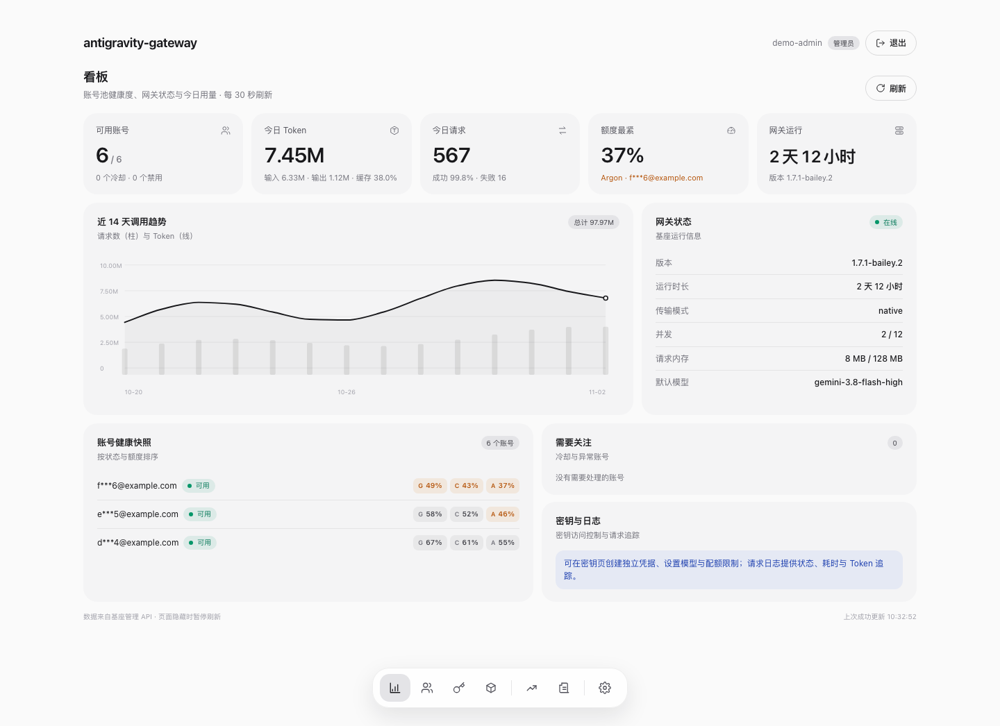
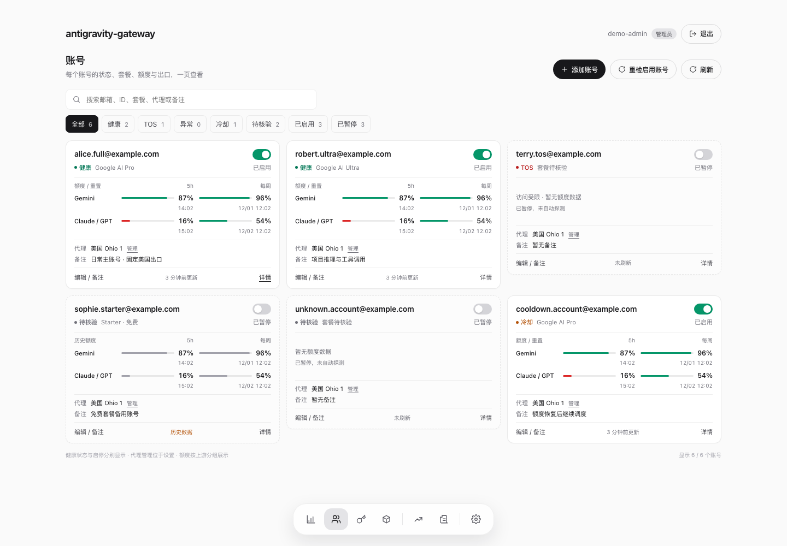
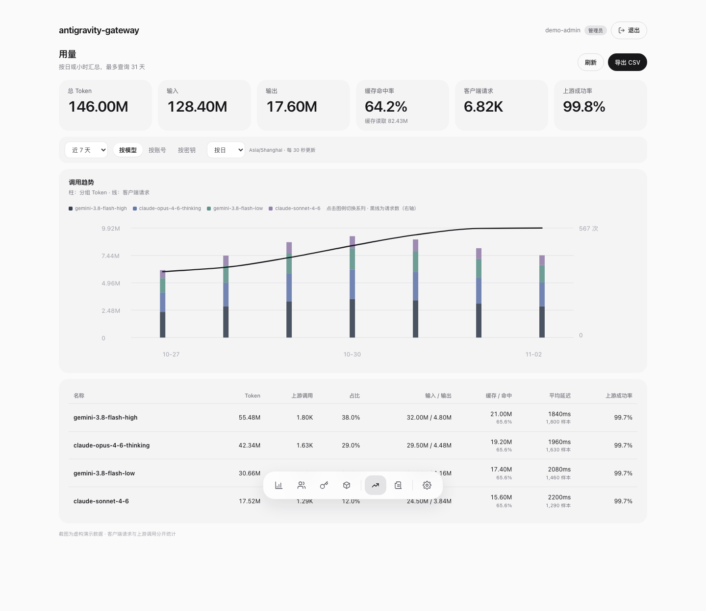
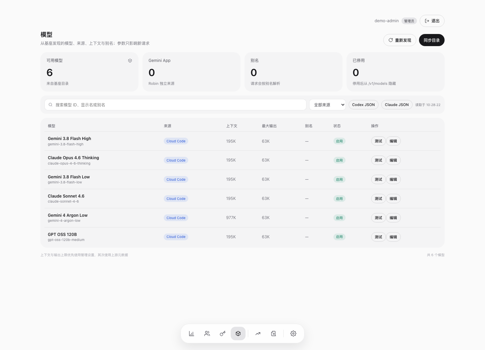
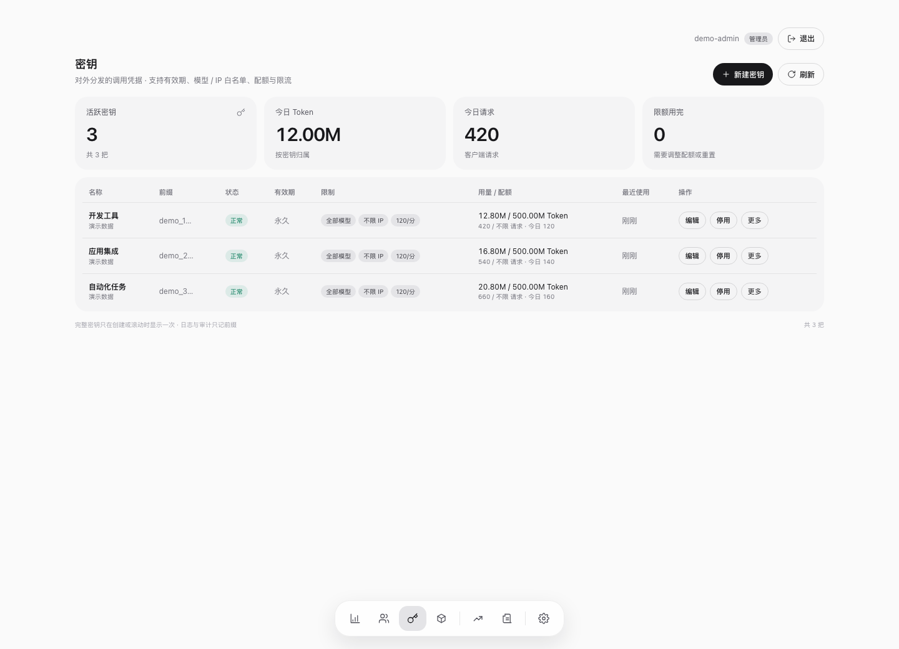
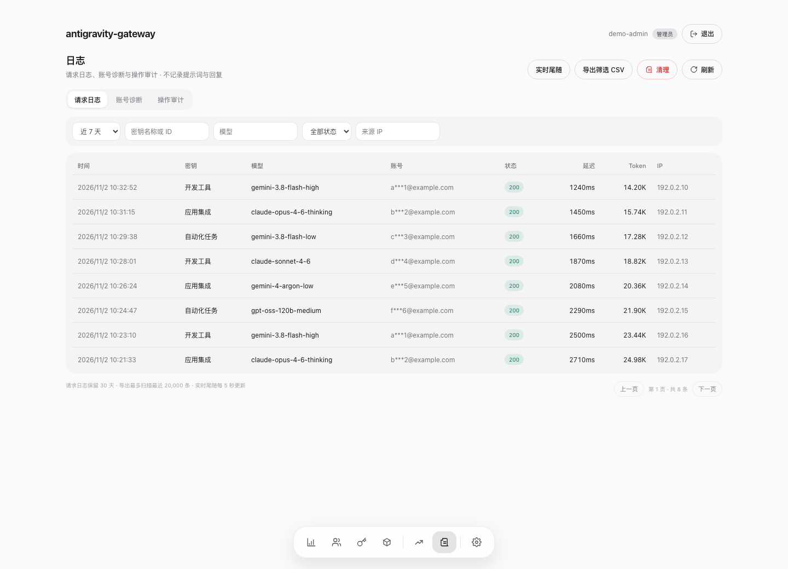
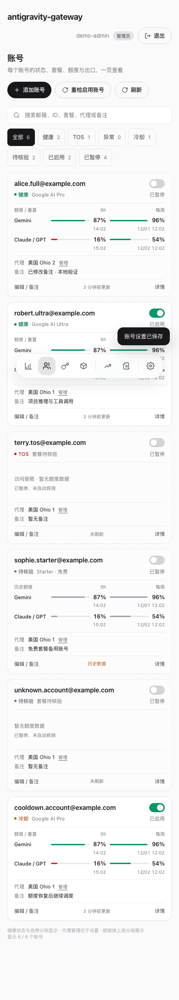
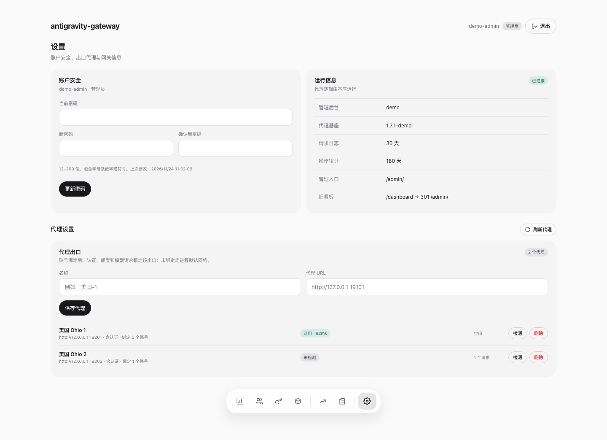
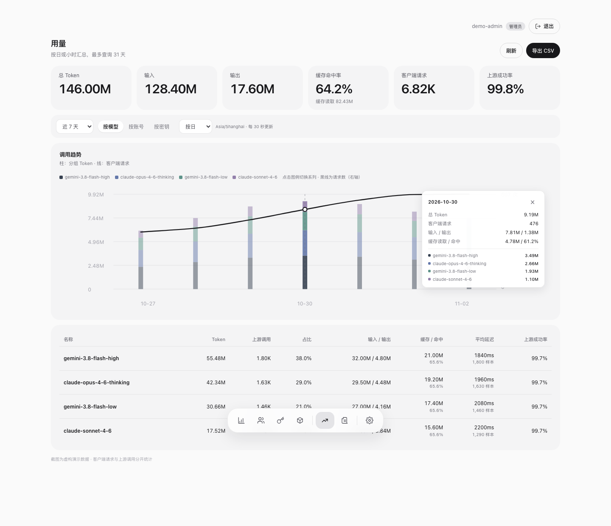

# Antigravity Gateway · Bailey Edition

[](https://github.com/baileyh8/antigravity-gateway/actions/workflows/ci.yml)

[仓库主页](https://github.com/baileyh8/antigravity-gateway) · [更新记录 / Changelog](CHANGELOG.md) · [管理后台 / Manager](manager/README.md) · [客户端适配指南 / Client Adaptation](docs/client-adaptation-guide.md) · [1.5.9 协议对照 / Compatibility](docs/agy-1.5.9-compatibility.md) · [贡献指南 / Contributing](CONTRIBUTING.md)

> **特别感谢上游作者 LeeFeee 和所有贡献者。** 本项目基于 [LeeFeee/antigravity-gateway](https://github.com/LeeFeee/antigravity-gateway) 独立维护，代理协议、基础网关能力和项目历史均源自上游。本维护线围绕“代理基座 + 独立管理后台”架构继续演进，保留上游历史、原作者版权与 [MIT 许可](LICENSE)。
>
> **With sincere thanks to LeeFeee and every upstream contributor.** This repository is an independently maintained fork of [LeeFeee/antigravity-gateway](https://github.com/LeeFeee/antigravity-gateway), developed around a separated proxy core and standalone management service. Original protocol work, project history, copyright attribution, and the [MIT license](LICENSE) are preserved.

**当前版本：`1.7.1-bailey.51`** · 代理基座与独立后台（Proxy core + separate admin）

- **代理基座（根目录）**：承担协议转换、直连传输、账号凭据、API 密钥、出口代理、额度调度与请求日志。npm 安装包仅包含基座。
- **独立管理后台（`manager/`）**：提供静态前端 `/admin/` 和独立 Node 管理 API，通过回环 `/_admin/v1` 访问基座，涵盖看板、账号卡片（完整邮箱、健康/TOS、套餐、启停、额度与重置时间、代理绑定、备注）、用量、日志、模型、密钥和设置（含代理管理）。账号筛选为平铺按钮。安装部署见 [manager/README.md](manager/README.md)。

### 新后台预览 / Admin preview

以下截图来自独立后台静态构建，使用虚构演示数据，不包含真实账号、密钥或线上流量。Screenshots show the built admin UI using synthetic demo data.



| 账号与分组额度 / Accounts & quota | 用量与缓存命中率 / Usage & cache |
| --- | --- |
|  |  |

| 模型管理 / Models | 密钥管理 / API keys |
| --- | --- |
|  |  |

| 请求日志 / Request logs | 移动端 / Mobile |
| --- | --- |
|  |  |

<details>
<summary>更多截图：代理设置与图表明细 / Proxy settings and chart details</summary>




</details>

[中文](#中文) · [English](#english)

---

## 中文

### 简介与核心能力

Antigravity Gateway 是运行在本机或服务器的 Anthropic / OpenAI 兼容代理网关。Claude Code、Codex CLI、Trae、DeepSeek Harness（DSH）、Hermes 及其他兼容客户端可以通过它调用账号可用的模型。网关支持导入本地 Antigravity CLI（`agy`）登录态，也可以维护独立的托管账号池。

默认使用原生 Cloud Code 直连（`direct`），不经过 `agy` Agent 的外层提示词包装。常规请求按客户端指定的模型 ID 原样发送，仅在识别到 Claude Code Auto Mode 分类请求时改用独立的快速模型。

> 非 Google 官方项目，仅供学习、兼容性研究与个人测试。模型权限、额度、地区限制和服务条款均以上游为准。完整版本演进见 [CHANGELOG.md](CHANGELOG.md) 与 [GitHub Releases](https://github.com/baileyh8/antigravity-gateway/releases)。

当前版本核心能力：

- **全协议与实时流式**：同时提供 Anthropic Messages（`/v1/messages`）、OpenAI Responses（`/v1/responses`）与 Chat Completions（`/v1/chat/completions`）。直连模式下，Anthropic 与 Responses 即使携带工具声明也会实时推送文本和思考流，结束前按原序补发工具调用及思考签名。
- **原生 Go 传输与 1.5.9 协议对齐**：内置 6 种平台/架构的原生传输二进制（普通安装无需 Go 环境；源码重建使用 `npm run build:native`，要求 Go 1.27.2）。模型 RPC 走 HTTP/1.1，OAuth 刷新走 HTTP/2，按账号代理地址复用独立 helper 进程。详见 [docs/agy-1.5.9-compatibility.md](docs/agy-1.5.9-compatibility.md)。
- **多账号池与分组额度调度**：Argon、Hydrogen、Gemini 与 Claude/GPT 共用统一 Cloud Code 账号池，按各账号实时模型目录过滤候选，并按模型组（Gemini、Claude/GPT、Argon）独立计算 5h 与周额度余量。内置 5h 10% / 周 5% 保留线、20/5 轮及 5 小时会话亲和、容量 503 冷却排队与异常账号隔离。
- **账号独立代理与一键启停**：每个账号可绑定独立 HTTP/HTTPS CONNECT 代理，认证刷新、额度查询、模型列表、对话与生图统一走绑定出口；代理故障不回落直连。独立后台支持在账号列表中一键启用或暂停账号并记录审计。
- **客户端与工具兼容**：内置 Claude Code / Claude Desktop SDK、Codex / OpenCodex、DSH、Hermes 的工具与指令适配，支持未知客户端语义推导和自定义工具往返。Schema 校验在 2 个有界 worker 中执行，带 2,048 条编译 LRU 缓存，不阻塞主线程。其他客户端（如 Pi、OpenClaw、OpenCode）如需自行适配，请看 [客户端适配指南](docs/client-adaptation-guide.md)。
- **多媒体、生图与安全边界**：支持 OpenAI Images/Files 接口、原生参考图编辑，以及图片、视频、音频、PDF 和普通文件理解。内置请求体与媒体内存预算、4+4 独立媒体/生图并发池、多密钥模式（`AGY_MULTI_KEY=1`）、受信任代理 IP 识别（`ANTIGRAVITY_TRUST_PROXY`）与优雅停机排空。

### 快速开始

#### 环境要求

| 条件 | 说明 |
| --- | --- |
| Node.js | 20 或更高版本（管理后台构建要求 Node.js 24 LTS） |
| 操作系统 | macOS、Linux 或 Windows（ARM64 / x64） |
| 账号授权 | 已登录的本机 `agy`，或含有效刷新凭据与 OAuth 客户端元数据的托管账号池 |
| 网络 | 本机或所绑定的出口代理能够访问 Antigravity / Google 上游服务 |

本项目不会自动安装 `agy` 或注册账号。使用 `direct` 传输且已有完整托管账号时，服务器无需安装 `agy`；本地登录态导入或显式使用 `agy` 子进程传输时才需要 CLI。

如需安装 Node.js，可使用 Homebrew（`brew install node`）、nvm（`nvm install 24`）、Windows `winget install --exact --id OpenJS.NodeJS.LTS`，或从 [Node.js 官网](https://nodejs.org/en/download/) 下载 LTS 版本。

#### 安装

`main` 是本仓库的默认安装与维护分支，可直接全局安装，无需先克隆仓库：

```bash
npm install --global --foreground-scripts --allow-scripts=antigravity-gateway https://github.com/baileyh8/antigravity-gateway/archive/refs/heads/main.tar.gz
```

验证版本：

```bash
antigravity-gateway --version
```

> 部分 npm 11 版本会提示 `install scripts not yet covered by allowScripts`。只要结尾显示 `changed 1 package` 且 `antigravity-gateway --version` 可正常运行，即表示安装成功。

#### 启动与后台服务

前台启动（适合首次导入账号或本地调试，按 `Ctrl+C` 停止）：

```bash
antigravity-gateway
```

默认监听地址：

```text
Anthropic: http://127.0.0.1:9897
OpenAI:    http://127.0.0.1:9897/v1
API Key:   antigravity-gateway（未启用自定义 Key 或多密钥模式时，任意非空值均可）
```

跨平台后台保活与开机自启（支持 macOS、Linux、Windows）：

```bash
antigravity-gateway service start
antigravity-gateway service status
antigravity-gateway service restart
antigravity-gateway service stop
antigravity-gateway service logs
antigravity-gateway service uninstall
```

重复执行 `service start` 会更新配置并重启现有服务。后台模式没有交互提示符；需要命令行添加账号时，先停止后台服务并以 `antigravity-gateway` 前台运行，完成后再执行 `service start`。

其他常用命令行选项：

```bash
antigravity-gateway stats                              # 在终端输出本地 Token 用量汇总（不启动 Web 服务）
antigravity-gateway --models                           # 查询当前可用模型列表
antigravity-gateway --diagnose-request sample.json     # 离线干跑诊断客户端请求兼容情况（不调用上游）
antigravity-gateway --agy-path "/absolute/path/to/agy" # 指定非默认位置的 agy 路径
```

### 账号池与常用命令

启动时网关会检查本机官方 `agy` 登录态：账号池中不存在该账号时自动导入并启用；已存在时不重复添加，也不覆盖已保存凭据。账号池非空后以池内凭据为主。

在前台模式的 `gateway>` 提示符下输入 `add` 可授权更多账号。终端会同时打印完整 OAuth 链接；远程主机无法直接打开本机回调时，将浏览器跳转后的完整 `localhost` 回调 URL 粘贴回 `gateway>` 即可。

账号凭据以 JSON 保存在 `~/.antigravity-gateway/accounts/`（POSIX 目录 `0700`、文件 `0600`，Windows 为当前用户独占 ACL）。Token 刷新仅合并凭据字段，以授权代次保护，不覆盖账号启停、权重、代理绑定或重新授权结果。

| 前台命令 | 作用 |
| --- | --- |
| `add` | 添加 Antigravity 账号 |
| `acc` / `accounts` | 查看账号池与健康状态 |
| `models` | 查看当前发现的模型 |
| `status` | 刷新网关状态与摘要看板 |
| `usage` | 查看实时详细用量 |
| `stats` | 在终端打印本地用量统计 |
| `reload` | 重新加载账号与额度快照 |
| `config` | 查看客户端连接示例配置 |
| `logs` | 查看日志位置或前台日志提示 |
| `clear` | 清屏并重绘状态 |
| `version` | 查看网关版本 |
| `help` | 查看命令帮助 |
| `quit` | 排空请求、保存状态并退出 |

> 额度查询在后台异步执行。启动画面中的 `1/1 额度可用` 仅表示当时已取得有效快照的账号数，等待数秒后输入 `status` 可刷新展示。

### 客户端接入

#### Claude Code

在 `~/.claude/settings.json` 的 `env` 中填入：

```json
{
  "env": {
    "ANTHROPIC_BASE_URL": "http://127.0.0.1:9897",
    "ANTHROPIC_AUTH_TOKEN": "antigravity-gateway",
    "ANTHROPIC_DEFAULT_OPUS_MODEL": "claude-opus-4-6-thinking",
    "ANTHROPIC_DEFAULT_SONNET_MODEL": "claude-sonnet-4-6",
    "ANTHROPIC_DEFAULT_HAIKU_MODEL": "gemini-3.8-flash-low",
    "CLAUDE_CODE_MAX_CONTEXT_TOKENS": "1048576"
  }
}
```

直接启动或加载网关自动生成的动态 `modelPicker`：

```bash
claude --model 'gemini-3.8-flash-high[1m]'

# macOS / Linux
claude --settings "$(antigravity-gateway --claude-config-path)"

# Windows PowerShell
claude --settings (antigravity-gateway --claude-config-path)
```

也可以运行 `antigravity-gateway --claude-config` 查看 JSON 并手动合并到 `~/.claude/settings.json`。使用本地网关时不要同时开启 `CLAUDE_CODE_USE_BEDROCK`、`CLAUDE_CODE_USE_VERTEX` 或 `CLAUDE_CODE_USE_FOUNDRY`。

#### Codex CLI

先获取网关生成的动态模型目录路径：

```bash
antigravity-gateway --codex-catalog-path
```

在 `~/.codex/config.toml` 中配置（Windows 路径建议用单引号）：

```toml
model = "gemini-3.8-flash-high"
model_provider = "antigravity"
model_catalog_json = "/ABSOLUTE/PATH/.antigravity-gateway/codex-models.json"

[model_providers.antigravity]
name = "Antigravity Gateway"
base_url = "http://127.0.0.1:9897/v1"
env_key = "ANTIGRAVITY_GATEWAY_API_KEY"
wire_api = "responses"
request_max_retries = 0
stream_max_retries = 0
```

设置环境变量后启动：

```bash
# macOS / Linux
export ANTIGRAVITY_GATEWAY_API_KEY=antigravity-gateway
codex

# Windows PowerShell
$env:ANTIGRAVITY_GATEWAY_API_KEY = "antigravity-gateway"
codex
```

#### Trae 及其他兼容客户端

| API 协议 | Base URL | API Key | 模型 |
| --- | --- | --- | --- |
| Anthropic Messages | `http://127.0.0.1:9897` | `antigravity-gateway` | 从 `/v1/models` 选择 |
| OpenAI Responses / Chat | `http://127.0.0.1:9897/v1` | `antigravity-gateway` | 从 `/v1/models` 选择 |

查询实时模型目录：

```bash
antigravity-gateway --models
curl http://127.0.0.1:9897/v1/models
```

#### 自研或第三方客户端适配

如果你使用 **Pi、OpenClaw、OpenCode** 或自研 Agent 框架，遇到系统提示词拒答、工具调用名/参数不兼容、思考参数报错或会话签名丢失等问题，请按 [客户端适配指南（docs/client-adaptation-guide.md）](docs/client-adaptation-guide.md) 抓包排查并按需 fork 扩展，不要盲目改写未知客户端的指令模板。

### 模型、思考与多模态

#### 动态模型目录与思考参数

- **以账号实时目录为准**：`/v1/models` 的 `data[]` 和扩展 `models[]` 返回各账号实时发现的真实模型 ID、上下文窗口、输出上限、媒体能力及思考档位，排除上游明确 `disabled` 的条目。模型目录仅用于展示与能力约束，不会拦截客户端主动指定的其他模型 ID。
- **Argon / Hydrogen / Sonar**：全部通过统一 Cloud Code 账号池调度，不再保留已退役的 Gemini App / Robin 通道。请使用目录返回的精确模型 ID（如 `gemini-4-argon-low/medium/high`、`gemini-4-hydrogen-low/medium/high/xhigh`、`gemini-4-hydrogen-sonar`）。
  - `gemini-4-hydrogen-xhigh` 映射数字 `thinkingLevel: 100`；Gemini 4 系列显式小 `thinking_budget` 自动保底 1024。
  - `gemini-4-hydrogen-sonar` 支持选择 `low` / `medium` / `high`（或数字 `1` / `2` / `3`，Chat 用 `reasoning_effort`，Responses 用 `reasoning.effort`，Anthropic 用 `output_config.effort`）；不传时使用目录默认 `LOW`，传入 `xhigh`/`minimal` 在本地直接返回 400。
  - `gemini-4-argon`、Carbon、Neon 等支持缺签名的旧工具历史兼容续接，已有真实思考签名始终优先保留。

#### 工具契约、压缩与指令封装

- **工具映射与 Schema 校验**：简单参数采用直接字段视图；复杂 Schema 或冲突字段自动降级为完整 JSON 兼容视图（含可读 MCP 兼容名与围栏 JSON 恢复），执行前由 2 个有界 Schema Worker 校验（2,048 条编译 LRU 缓存、排队上限 32 项 / 8 MiB、空闲 30 秒回收）。如需短期回退历史工具格式，可设置 `ANTIGRAVITY_TOOL_CONTRACT=legacy`。
- **指令封装与签名隔离**：仅对指纹验证通过的客户端框架（如 Claude Desktop SDK、Codex Desktop、Hermes）执行指令分离封装，且封装步骤在原生历史与签名恢复之后运行，避免多轮对话破坏签名链。Neon 模型如需启用不依赖客户端版本的通用指令封装，可设 `ANTIGRAVITY_SEMANTIC_INSTRUCTION_ENVELOPE=1`。
- **Responses 上下文压缩**：支持纯文本 `compaction` 项并保留工具签名历史；上游无法解包的加密摘要（`encrypted_content`）会在本地明确返回 400。
- **静默空流保护**：若上游流式响应返回 HTTP 200 但 0 token 且无任何内容、思考或工具调用，网关明确返回 `502 empty_upstream_response` 并记入日志，不向上游客户端伪造空成功。

#### 图片生成与多媒体理解

常规对话不使用关键词路由：网关将文本和附件一并交给客户端选定的 Gemini 模型，仅在用户明确要求生成或编辑图片时，模型才触发内置私有生图工具；客户端自有工具与 `tool_choice` 语义保持不变。

```bash
# 文生图
curl http://127.0.0.1:9897/v1/images/generations \
  -H 'Content-Type: application/json' \
  -d '{"prompt":"白色背景中央的黑色六边形","size":"1024x1024","response_format":"url"}'

# 参考图编辑（最多 3 张）
curl http://127.0.0.1:9897/v1/images/edits \
  -F 'image=@reference.png' \
  -F 'prompt=只把主体颜色改为紫色，其他内容不变' \
  -F 'response_format=url'

# 上传文件供远程客户端复用（图片、视频、音频、PDF 等）
curl http://127.0.0.1:9897/v1/files \
  -F 'file=@recording.mp4;type=video/mp4' \
  -F 'purpose=assistants'
```

- 无法透传请求体 `response_format` 的转发链路可加请求头 `X-AGY-Image-Response-Format: b64_json`（请求体字段优先）。
- `/v1/files` 返回的 `file_...` 可直接放进 Anthropic `source.file_id`、Chat `file_id`/`input_image`/`input_video` 或 Responses `input_file`/`input_image`/`input_video`；也支持 Data URL、HTTP(S) URL 和本机绝对路径。媒体文件保存在 `~/.antigravity-gateway/media/`，内容接口支持 `GET` 与 `HEAD`。
- 生图回复同时提供文本回执、Markdown、可访问 URL、本机路径与 `artifacts` 结构化字段。
- 如果 Agent 无法自行构造视频输入，可使用随包附带的 `skills/antigravity-video-understanding`：

```bash
python3 skills/antigravity-video-understanding/scripts/analyze_video.py \
  "/absolute/path/recording.mp4" \
  --prompt "分析这段视频并回答我的问题"
```

#### 用量与缓存统计

- **Anthropic Messages**：`input_tokens` 扣除缓存读取量（`prompt - cache_read`），避免客户端重复计费；缓存命中由 `cache_read_input_tokens` 上报。
- **OpenAI Chat Completions**：`prompt_tokens` 保留包含缓存的前缀总数，缓存与思考用量分别写入 `prompt_tokens_details.cached_tokens` 和 `completion_tokens_details.reasoning_tokens`。流式用量遵循 `stream_options.include_usage: true`（中间块 `usage: null`，末尾单独发送用量块）。
- 缓存由上游隐式处理，不创建 `cachedContents`，统计均取自上游真实返回值；不承诺固定命中阈值或折扣。
- 状态与统计落盘位置：
  - `~/.antigravity-gateway/state/account-pool.json`（账号路由哈希、健康状态与亲和计数，不含提示词或凭据）
  - `~/.antigravity-gateway/state/quota.json`（内存额度快照持久化）
  - `~/.antigravity-gateway/usage/usage-state.json`（用量数字统计）

### 账号调度、代理与独立后台

#### 分组额度优先与保留线

- **按模型组独立比较**：Gemini、Claude/GPT、Argon 三组分别读取各自的 5h 与周额度快照，缺失组不借用其他组余额。
- **保留线**：任一有效窗口到达 **5h 剩余 ≤ 10%** 或 **周剩余 ≤ 5%** 时停止向该账号派发该组新请求（粘性会话、排队和兜底均遵守）。所有账号均达保留线时返回 `429 quota_reserve_reached`。受在途请求与上游刷新延迟影响，最终余额可能略低于保留线。
- **余量排序**：计算各有效窗口的可用余量 `(剩余比例 - 保留比例) / (1 - 保留比例)`，先比两项中较紧的一项，再比另一项；完整读数优先于部分读数与未知读数；同等余量按账号权重轮询。
- **快照刷新**：后台约每 30 分钟全量刷新一次；活跃账号最短每 1 分钟补查摘要，当前组余量 ≤ 20% 时缩短至 15 秒（最多 2 个账号并发刷新，请求自动合并）。

#### 会话亲和与容错

- **亲和窗口与轮换**：按「路由会话 × 账号 × 模型组」计数，固定窗口 **5 小时**（`ANTIGRAVITY_AFFINITY_TTL_SECONDS`），默认连续 **20 次成功模型请求**后重选账号；该组任一有效窗口 ≤ 20% 时缩短为 **5 次**，以先到达者为准。支持显式请求头 `x-client-id`/`x-agent-id`、`x-session-id`/`x-conversation-id`、`x-parent-session-id`、`x-routing-affinity-id`（原始标识仅留本地，上游仅接收不可逆哈希）。
- **容量 503 与限流保护**：明确的 `MODEL_CAPACITY_EXHAUSTED`（503）及无配额细节的 `RESOURCE_EXHAUSTED`（429）不再在入口与账号间立即重试放大，而是按模型进入冷却并保留上游 `Retry-After`，不误判账号失效或降级模型。直连 Responses 默认等上游接受后再开启 SSE；旧客户端如需提前开流可传 `X-AGY-Defer-Stream-Start: 0`。
- **认证与风控隔离**：认证失效、访问受限或 Google 安全核验会将账号标记异常并暂停派发；重新授权后自动恢复，也可在管理后台执行不消耗 Token 的“重新检测”。

#### 账号独立代理与管理后台

在独立后台 `/admin/accounts/` 中可维护 HTTP/HTTPS CONNECT 代理并为账号绑定出口，也能直接在账号列表通过一键开关启用或暂停账号（即时生效并写入审计日志）。

- 绑定代理后，该账号的聊天、生图、模型目录、OAuth 刷新与额度查询均走同一代理；代理故障直接报错，不回退进程网络或直连（账号池仍可故障转移到其他账号）。
- 未绑定账号及首次 OAuth 登录继续走进程网络配置。代理绑定保存在 `proxies.json`（`0600`），与账号凭据文件分离。不支持 SOCKS 或内置节点轮换。
- 旧版内置 `/dashboard` 已从基座移除并返回 404。管理后台通过回环 `/_admin/v1` + `X-Agy-Admin-Token` 与基座通信，**严禁将 `/_admin` 暴露到公网**。代理管理内部接口如下：

| 方法 | 路径 | 用途 |
| --- | --- | --- |
| `GET` | `/_admin/v1/proxies` | 脱敏代理列表、绑定关系、在途请求数与上次连通性检测 |
| `POST` | `/_admin/v1/proxies` | 新增或更新代理 `{id?, name, url?}` |
| `DELETE` | `/_admin/v1/proxies/:id` | 删除未绑定且空闲的代理 |
| `POST` | `/_admin/v1/proxies/:id/check` | 检测固定 Google HTTPS 目标连通性 |
| `PUT` | `/_admin/v1/accounts/:id/proxy` | 绑定 `{proxyId}` 或传 `null` 解除绑定 |

#### 多密钥与反向代理安全

- **多密钥模式（`AGY_MULTI_KEY=1`）**：可在管理后台 `/admin/keys/` 为不同客户端签发独立密钥、模型限制和 IP 白名单。确认客户端迁移完成后，可从环境中移除旧 `ANTIGRAVITY_GATEWAY_API_KEY`；后台模型测试会自动签发并清理短期单模型临时密钥。
- **受信任代理（`ANTIGRAVITY_TRUST_PROXY`）**：网关默认仅信任回环代理（`127.0.0.1/8,::1`），从 `X-Forwarded-For` 右起取首个非受信任跳作为真实客户端 IP，用于密钥白名单与请求日志；管理后台对应变量为 `AGY_MANAGER_TRUST_PROXY`。若网关直连客户端而不经过本机反代，可设为 `off`。

### 并发与资源保护

| 类别 | 默认上限 | 说明 |
| --- | --- | --- |
| 全局模型推理 | `60`（`agy` 模式 `4`） | 文本、工具与多媒体输入共用；单模型理论上限为「支持账号数 × 5」，不超过全局上限 |
| 单账号推理 | `5` | 同一账号跨所有模型共享 5 路；绑定账号满载时可在派发前切换其他空闲账号 |
| 生图 / 图片编辑 | `4` | Images API 与对话内置生图工具共用独立池；单次 `n` 张顺序生成 |
| 多媒体输入 / 上传 | `4` | 图片、视频、音频、PDF 输入与 Files 上传合计 4 路（可与生图池同时 4+4 运行） |
| 共享等待队列 | `120` 项 / `30s` | 跨准入阶段共享队列与累计排队超时；队列满返回 `429` + `Retry-After` |

内存与流式边界（均为估算预算，非进程 RSS 硬限制）：

- **HTTP 请求体预算**：默认 `384 MiB`（按接收字节 3 倍估算），超限返回可重试 `503`。
- **已解析媒体预算**：默认 `512 MiB`（按二进制 4 倍估算），超限返回 `503`。
- **Responses 历史缓存**：默认 `64 MiB`（含 TTL、条数与 LRU 淘汰；`store: false` 或超限条目不留存）。
- **单客户端 SSE 缓冲**：默认 `8 MiB`，持续背压超时会主动断开慢客户端。
- **媒体磁盘上限**：默认关闭（`0`），显式配置后超限返回 `507` 且不自动删旧文件。
- **优雅停机**：停机先停止新请求、在 `30s` 内排空在途任务，再刷盘用量并关闭代理连接。回环接口 `/_admin/v1/overview` 的 `concurrency` 字段可实时查看各池与内存预算占用。

### 常用配置

非必要不建议手动设置 `ANTIGRAVITY_ACCESS_TOKEN`、`ANTIGRAVITY_REFRESH_TOKEN`、`ANTIGRAVITY_PROJECT_ID` 或上游地址。

| 环境变量 | 默认值 | 说明 |
| --- | --- | --- |
| `ANTIGRAVITY_GATEWAY_HOST` | `127.0.0.1` | 监听地址；非回环监听时必须启用 API Key 或多密钥模式 |
| `ANTIGRAVITY_GATEWAY_PORT` | `9897` | 监听端口 |
| `ANTIGRAVITY_GATEWAY_API_KEY` | 空 | 单主密钥；启用 `AGY_MULTI_KEY=1` 且迁移完成后可移除 |
| `AGY_MULTI_KEY` | 关闭 | 设为 `1` 启用独立管理后台多密钥与 IP/模型限制 |
| `ANTIGRAVITY_TRUST_PROXY` | `loopback` | 受信任反代 CIDR 列表（`off` 禁用；默认 `127.0.0.1/8,::1`） |
| `ANTIGRAVITY_GATEWAY_CORS_ORIGIN` | 空 | 允许浏览器跨域访问的 Origin 列表（逗号分隔） |
| `ANTIGRAVITY_GATEWAY_CONFIG_DIR` | `~/.antigravity-gateway` | 账号、额度、用量、媒体和客户端目录存储路径 |
| `ANTIGRAVITY_CLI_PATH` | 自动查找 `agy` | 指定 `agy` 可执行文件路径 |
| `ANTIGRAVITY_LOCAL_AUTH_FILE` | 自动读取 | 指定本地 `agy` 登录态文件 |
| `ANTIGRAVITY_CLI_VERSION` | `1.5.9` | 上游请求客户端标识版本（须与 `CHANGELIST` 成对修改） |
| `ANTIGRAVITY_CLI_CHANGELIST` | `1021519450` | 对应官方构建 changelist（`cl`） |
| `ANTIGRAVITY_DEFAULT_MODEL` | `gemini-3.8-flash-high` | 请求未指定模型时的默认模型 |
| `ANTIGRAVITY_FAST_MODEL` | 自动选择 | Claude Code Auto Mode 分类请求使用的快速模型 |
| `ANTIGRAVITY_MODEL_ALIASES` | `{}` | 精确模型别名 JSON 映射 |
| `ANTIGRAVITY_IMAGE_MODEL` | `gemini-3.1-flash-image` | 原生生图模型 |
| `ANTIGRAVITY_TOOL_CONTRACT` | 新合同 | 设为 `legacy` 短期回退历史工具格式 |
| `ANTIGRAVITY_TOOL_SEMANTICS` | `on` | 设为 `off` 关闭未抓包客户端工具语义推导，恢复严格透传 |
| `ANTIGRAVITY_SEMANTIC_INSTRUCTION_ENVELOPE` | `0` | 按协议角色做通用指令封装：`0`/`off` 关闭，`1`/`neon` 仅 Neon，`gemini4` 覆盖全部 Gemini 4，`all` 覆盖全部 Gemini |
| `ANTIGRAVITY_GATEWAY_TOOL_NARRATION` | 关闭 | 设为 `1` 在带工具请求的系统指令末尾追加按阶段汇报进度约定（不影响 Auto Mode 与结构化输出） |
| `ANTIGRAVITY_TOOL_MAPPING_TRACE` | 空 | 设为 `on` 按请求记录 `profile=... mapped=N/M` |
| `ANTIGRAVITY_TOOL_MAPPING_DEBUG` | 空 | 设为 `on` 输出逐工具映射明细 |
| `ANTIGRAVITY_GATEWAY_DEBUG` | 空 | 设为 `1` 输出更多诊断日志 |
| `ANTIGRAVITY_DIRECT_MODEL_DISCOVERY_TIMEOUT_MS` | `8000` | 模型目录探测超时（ms） |
| `ANTIGRAVITY_GATEWAY_TIMEOUT_MS` | `300000` | 单次请求总超时（ms）；超时后 Responses 流发 `response.failed` / `request_timeout` |
| `ANTIGRAVITY_GATEWAY_MAX_CONCURRENCY` | `60`（`agy` 为 `4`） | 全局最大推理并发 |
| `ANTIGRAVITY_GATEWAY_ACCOUNT_CONCURRENCY` | `5` | 单账号最大推理并发 |
| `ANTIGRAVITY_GATEWAY_MAX_QUEUE` | `120` | 共享队列上限 |
| `ANTIGRAVITY_GATEWAY_QUEUE_TIMEOUT_MS` | `30000` | 跨准入阶段累计排队超时（ms） |
| `ANTIGRAVITY_AFFINITY_TTL_SECONDS` | `18000` | 账号软亲和固定窗口（秒，默认 5 小时，成功不续期） |
| `ANTIGRAVITY_GATEWAY_MEDIA_CONCURRENCY` | `4` | 多媒体输入与文件上传并发池上限 |
| `ANTIGRAVITY_GATEWAY_IMAGE_CONCURRENCY` | `4` | 生图与原生生图工具并发池上限 |
| `ANTIGRAVITY_GATEWAY_MEDIA_LIMIT` | `100663296` (96 MiB) | 单个多媒体文件解析上限（字节） |
| `ANTIGRAVITY_GATEWAY_TOTAL_MEDIA_LIMIT` | `201326592` (192 MiB) | 单次对话解析的多媒体总上限（字节） |
| `ANTIGRAVITY_GATEWAY_REQUEST_MEMORY_BYTES` | `402653184` (384 MiB) | 共享请求体估算内存预算 |
| `ANTIGRAVITY_GATEWAY_RESOLVED_MEDIA_MEMORY_BYTES` | `536870912` (512 MiB) | 共享已解析媒体估算内存预算 |
| `ANTIGRAVITY_GATEWAY_SESSION_CACHE_BYTES` | `67108864` (64 MiB) | Responses 历史缓存字节上限 |
| `ANTIGRAVITY_GATEWAY_SSE_BUFFER_BYTES` | `8388608` (8 MiB) | 单客户端 SSE 写入缓冲上限 |
| `ANTIGRAVITY_GATEWAY_MEDIA_DISK_BYTES` | `0`（关闭） | 媒体目录磁盘上限（字节），超限返回 `507` |
| `ANTIGRAVITY_GATEWAY_SHUTDOWN_TIMEOUT_MS` | `30000` | 停机排空超时（ms） |
| `AGY_LOG_RETENTION_DAYS` / `AGY_LOG_MAX_BYTES` | `30` / `500 MiB` | 请求日志保留天数与总容量上限 |

> 开启 `ANTIGRAVITY_GATEWAY_TOOL_NARRATION=1` 后，可通过 `curl -s http://127.0.0.1:9897/ | grep -o '"tool_narration":[a-z]*'` 检查是否生效。该选项为提示词约定，仅作用于 `direct` 传输的带工具请求。

### 接口速查与更新维护

#### HTTP 接口

```text
GET    /
GET    /v1/models
POST   /v1/files
GET    /v1/files/:id
GET    /v1/files/:id/content
DELETE /v1/files/:id
POST   /v1/images/generations
POST   /v1/images/edits
POST   /v1/messages
POST   /v1/messages/count_tokens
POST   /v1/responses
POST   /v1/chat/completions
```

#### 更新与卸载

```bash
# 更新到 main 最新版本
npm install --global --foreground-scripts --allow-scripts=antigravity-gateway https://github.com/baileyh8/antigravity-gateway/archive/refs/heads/main.tar.gz

# 重启后台服务使新版本生效（前台模式按 Ctrl+C 重启）
antigravity-gateway service start

# 卸载
antigravity-gateway service uninstall
npm uninstall --global antigravity-gateway
```

#### 常见问题与诊断

- **`401 本地 agy 登录态刷新失败`**：在官方 `agy` 重新登录并完成一次对话，重启网关后输入 `acc` 检查；如后台仍标异常，点击“重新检测”。
- **`429 Resource has been exhausted` / `503 MODEL_CAPACITY_EXHAUSTED`**：账号额度受限或上游模型容量不足。网关会遵守保留线与冷却队列，请等待恢复、切换模型或补充账号。
- **`EADDRINUSE 127.0.0.1:9897`**：端口已被占用，关闭旧进程或使用 `antigravity-gateway --port 9898` 并同步修改客户端 Base URL。
- **Claude Code 请求未进入网关**：检查 `ANTHROPIC_BASE_URL`，移除 Bedrock/Vertex/Foundry 开关；系统代理环境下设置 `export NO_PROXY=127.0.0.1,localhost`。
- **启动时只发现少量模型**：探测可能暂时超时，输入 `reload` / `models` 或运行 `antigravity-gateway --models` 刷新。客户端显式指定的模型仍可直接发送。
- **鉴权与休眠诊断日志**：账号隔离、Token 刷新阶段、手动复检与系统休眠断层会写入 `~/.antigravity-gateway/logs/auth-diagnostics.jsonl`（约 5 MB 轮转 `.1`，不含凭据或对话内容），可用 `tail -f` 实时查看。

### 已知限制与许可

- 直连传输、原生生图和多媒体协议均基于非公开 Cloud Code 内部接口，上游变更后可能需要同步适配。
- 可用模型、上下文长度、隐式缓存命中率与额度均由上游决定，本项目不绕过上游限制，也不承诺消除上游容量不足或 429 限流。
- Claude Code Auto Mode 分类请求与结构化输出请求仍会先完整校验再返回客户端。
- 本地账号文件、代理配置与管理令牌属于敏感文件，请由部署方妥善保管权限，勿提交到公开仓库。
- 本仓库采用 **MIT 许可**，详见 [LICENSE](LICENSE)。问题反馈与贡献请提交至 [baileyh8/antigravity-gateway](https://github.com/baileyh8/antigravity-gateway)。

---

## English

### Overview & key capabilities

Antigravity Gateway is an Anthropic/OpenAI-compatible proxy gateway for local or server deployment. It lets Claude Code, Codex CLI, Trae, DeepSeek Harness (DSH), Hermes, and other compatible clients call models available on imported local Antigravity CLI (`agy`) credentials or a managed account pool.

The default `direct` transport talks directly to Cloud Code without the `agy` Agent wrapper prompt. Normal requests forward the exact model ID chosen by the client; only detected Claude Code Auto Mode classifier calls use a separate fast model.

> Unofficial project intended for learning, compatibility research, and personal testing. Upstream plans, quotas, regional rules, and terms of service always apply. See [CHANGELOG.md](CHANGELOG.md) and [GitHub Releases](https://github.com/baileyh8/antigravity-gateway/releases) for full version history.

Key capabilities in `1.7.1-bailey.51`:

- **Full protocol coverage with live streaming**: Exposes Anthropic Messages (`/v1/messages`), OpenAI Responses (`/v1/responses`), and Chat Completions (`/v1/chat/completions`). In direct mode, Anthropic and Responses stream text and thinking deltas live even when tools are declared, emitting thought-signature carriers and tool calls in order before completion.
- **Native Go transport aligned with agy CLI 1.5.9**: Bundles verified native helper binaries for 6 OS/arch targets (no Go toolchain required for normal installs; `npm run build:native` requires Go 1.27.2). Model RPCs use HTTP/1.1 while OAuth refreshes use HTTP/2, with isolated helper reuse per account proxy. See [docs/agy-1.5.9-compatibility.md](docs/agy-1.5.9-compatibility.md).
- **Managed account pool & group-aware quota scheduling**: Argon, Hydrogen, Gemini, and Claude/GPT share one Cloud Code pool filtered by each account's live model catalog. Scheduling compares usable headroom per quota group (Gemini, Claude/GPT, Argon) with a 10% five-hour / 5% weekly reserve, 20/5-turn and 5-hour sticky affinity, model-scoped capacity 503 cooldowns, and automatic quarantine on auth/challenge failures.
- **Per-account proxies & standalone admin**: Bind an HTTP/HTTPS CONNECT proxy per account so auth refreshes, quota probes, model discovery, chat, and image requests all share the same egress without falling back to direct access. The standalone `/admin/` UI shows full account emails across account cards, dashboard, usage and logs, with inline enable/pause switches and audit logging.
- **Client & tool compatibility**: Built-in adapters for Claude Code / Claude Desktop SDK, Codex / OpenCodex, DSH, and Hermes, plus semantic tool inference and custom tool round-tripping for unknown clients. JSON Schema validation runs in 2 bounded workers with a 2,048-entry compiled LRU cache off the main thread. For adapting other clients (such as Pi, OpenClaw, or OpenCode), see [docs/client-adaptation-guide.md](docs/client-adaptation-guide.md).
- **Multimodal, images & safeguards**: Supports OpenAI Images/Files APIs, native reference-image editing, and image/video/audio/PDF/file inputs, alongside request/media memory budgets, separate 4+4 media/image pools, multi-key auth (`AGY_MULTI_KEY=1`), trusted-proxy IP resolution (`ANTIGRAVITY_TRUST_PROXY`), and graceful shutdown draining.

### Quick start

#### Requirements

| Requirement | Details |
| --- | --- |
| Node.js | 20 or newer (`manager/` build requires Node.js 24 LTS) |
| OS | macOS, Linux, or Windows (ARM64 / x64) |
| Accounts | Signed-in local `agy`, or managed pool credentials with valid refresh tokens and OAuth client metadata |
| Network | Access to Antigravity / Google upstream directly or via bound account proxies |

This package does not install `agy` or create accounts. With `direct` transport and complete managed account JSON files, `agy` is not needed on the server; local auth discovery and explicit `agy` subprocess transport still require the CLI.

#### Install

`main` is the default installation and maintenance branch. Install globally from any directory:

```bash
npm install --global --foreground-scripts --allow-scripts=antigravity-gateway https://github.com/baileyh8/antigravity-gateway/archive/refs/heads/main.tar.gz
antigravity-gateway --version
```

> Some npm 11 versions print `install scripts not yet covered by allowScripts`. If the output ends with `changed 1 package` and `antigravity-gateway --version` runs, installation succeeded.

#### Run & background service

Foreground mode (`Ctrl+C` to stop):

```bash
antigravity-gateway
```

Default endpoints:

```text
Anthropic: http://127.0.0.1:9897
OpenAI:    http://127.0.0.1:9897/v1
API Key:   antigravity-gateway (any non-empty value when no custom key or multi-key mode is set)
```

Background keepalive and autostart (macOS, Linux, Windows):

```bash
antigravity-gateway service start
antigravity-gateway service status
antigravity-gateway service restart
antigravity-gateway service stop
antigravity-gateway service logs
antigravity-gateway service uninstall
```

Re-running `service start` updates configuration and restarts the existing service. Background mode is non-interactive; stop the service and run `antigravity-gateway` in the foreground when adding accounts via CLI, then run `service start` again.

Other CLI helpers:

```bash
antigravity-gateway stats                              # Print local token usage totals in terminal
antigravity-gateway --models                           # List discovered models
antigravity-gateway --diagnose-request sample.json     # Offline dry-run client compatibility check
antigravity-gateway --agy-path "/absolute/path/to/agy" # Custom agy binary path
```

### Account pool & foreground commands

On startup, a usable local official `agy` account is imported into the pool if not already present (existing entries are never duplicated or overwritten). Once the pool is non-empty, requests use stored pool credentials.

Type `add` at the foreground `gateway>` prompt to authorize additional accounts. The full OAuth URL is always printed; on headless servers, paste the final `localhost` callback URL from your browser back into `gateway>`.

Credentials are stored as JSON under `~/.antigravity-gateway/accounts/` (`0700` dir / `0600` file on POSIX; user-only ACL on Windows). Token refreshes only merge credential fields with auth-generation protection, never overwriting enable/pause state, weights, proxy bindings, or newer authorizations.

| Command | Purpose |
| --- | --- |
| `add` | Add an Antigravity account |
| `acc` / `accounts` | Show account pool and health state |
| `models` | Show discovered models |
| `status` | Refresh gateway and quota summary |
| `usage` | Show live detailed usage |
| `stats` | Print local usage totals |
| `reload` | Reload accounts and quota snapshots |
| `config` | Print sample client configuration |
| `logs` | Show log path or foreground log note |
| `clear` | Clear screen and redraw status |
| `version` | Show gateway version |
| `help` | Show command help |
| `quit` | Drain requests, flush state, and exit |

### Client setup

#### Claude Code

Add to `env` in `~/.claude/settings.json`:

```json
{
  "env": {
    "ANTHROPIC_BASE_URL": "http://127.0.0.1:9897",
    "ANTHROPIC_AUTH_TOKEN": "antigravity-gateway",
    "ANTHROPIC_DEFAULT_OPUS_MODEL": "claude-opus-4-6-thinking",
    "ANTHROPIC_DEFAULT_SONNET_MODEL": "claude-sonnet-4-6",
    "ANTHROPIC_DEFAULT_HAIKU_MODEL": "gemini-3.8-flash-low",
    "CLAUDE_CODE_MAX_CONTEXT_TOKENS": "1048576"
  }
}
```

Launch with a 1M context declaration or the generated dynamic `modelPicker`:

```bash
claude --model 'gemini-3.8-flash-high[1m]'

# macOS / Linux
claude --settings "$(antigravity-gateway --claude-config-path)"

# Windows PowerShell
claude --settings (antigravity-gateway --claude-config-path)
```

Do not enable `CLAUDE_CODE_USE_BEDROCK`, `CLAUDE_CODE_USE_VERTEX`, or `CLAUDE_CODE_USE_FOUNDRY` when targeting the local gateway.

#### Codex CLI

Print the generated catalog path with `antigravity-gateway --codex-catalog-path`, then configure `~/.codex/config.toml` (use single quotes for Windows paths):

```toml
model = "gemini-3.8-flash-high"
model_provider = "antigravity"
model_catalog_json = "/ABSOLUTE/PATH/.antigravity-gateway/codex-models.json"

[model_providers.antigravity]
name = "Antigravity Gateway"
base_url = "http://127.0.0.1:9897/v1"
env_key = "ANTIGRAVITY_GATEWAY_API_KEY"
wire_api = "responses"
request_max_retries = 0
stream_max_retries = 0
```

```bash
export ANTIGRAVITY_GATEWAY_API_KEY=antigravity-gateway
codex
```

#### Trae & other compatible clients

| Protocol | Base URL | API Key | Model |
| --- | --- | --- | --- |
| Anthropic Messages | `http://127.0.0.1:9897` | `antigravity-gateway` | Pick from `/v1/models` |
| OpenAI Responses / Chat | `http://127.0.0.1:9897/v1` | `antigravity-gateway` | Pick from `/v1/models` |

For third-party or custom clients (such as **Pi, OpenClaw, or OpenCode**), follow [docs/client-adaptation-guide.md](docs/client-adaptation-guide.md) to capture traffic, isolate protocol vs. framework issues, and build clean fork adapters without guessing on unknown prompt layouts.

### Models, thinking & multimodal

#### Live model catalog & thinking controls

- `/v1/models` returns actual per-account Cloud Code metadata (IDs, context/output limits, media flags, and supported thinking levels) in both `data[]` and extended `models[]`, excluding explicitly `disabled` entries.
- **Argon / Hydrogen / Sonar** all use the unified Cloud Code pool (the retired Gemini App / Robin channel is removed). Always pick exact catalog IDs such as `gemini-4-argon-low/medium/high`, `gemini-4-hydrogen-low/medium/high/xhigh`, and `gemini-4-hydrogen-sonar`.
  - `gemini-4-hydrogen-xhigh` maps to numeric `thinkingLevel: 100`; small explicit `thinking_budget` values on Gemini 4 models clamp to a 1024 floor.
  - `gemini-4-hydrogen-sonar` accepts selectable `low` / `medium` / `high` (or `1` / `2` / `3` via `reasoning_effort`, `reasoning.effort`, or `output_config.effort`), defaulting to catalog `LOW` and rejecting `xhigh`/`minimal` locally with HTTP 400.
  - Unsigned legacy tool history is supported on Argon, Carbon, and Neon while always preferring genuine thought signatures.

#### Tool contracts, compaction & instruction envelopes

- Simple schemas use direct fields; complex or conflicting schemas fall back to a full JSON view (with readable MCP compatibility names and fenced `argumentsJson` recovery) validated by 2 bounded schema workers (2,048-entry compiled LRU cache, 32 queued / 8 MiB, 30s idle retirement). Set `ANTIGRAVITY_TOOL_CONTRACT=legacy` for temporary rollback.
- Fingerprint-verified instruction envelopes run after native context/signature restoration so multi-turn thought-signature chains stay intact. Set `ANTIGRAVITY_SEMANTIC_INSTRUCTION_ENVELOPE=1` to enable version-independent semantic envelopes for Neon.
- Responses plaintext `compaction` items are supported; opaque `encrypted_content` items fail cleanly with HTTP 400.
- Silent 0-token upstream streams with no text, thinking, or tool calls return `502 empty_upstream_response` instead of a fake empty success.

#### Images, files & usage accounting

Normal chat has no keyword router: text and attachments go to the selected Gemini model, which invokes the private native image tool only when asked to create or edit an image.

```bash
# Text to image
curl http://127.0.0.1:9897/v1/images/generations \
  -H 'Content-Type: application/json' \
  -d '{"prompt":"a black hexagon on white","size":"1024x1024","response_format":"url"}'

# Reference-image edit (up to 3 images)
curl http://127.0.0.1:9897/v1/images/edits \
  -F 'image=@reference.png' \
  -F 'prompt=change only the subject to purple' \
  -F 'response_format=url'

# Upload media for remote clients
curl http://127.0.0.1:9897/v1/files \
  -F 'file=@recording.mp4;type=video/mp4' \
  -F 'purpose=assistants'
```

- Relays that cannot forward `response_format` in the body may send `X-AGY-Image-Response-Format: b64_json`.
- Returned `file_...` IDs work across Anthropic, Chat, and Responses media blocks alongside Data URLs, HTTP(S) URLs, and local paths. Files live in `~/.antigravity-gateway/media/` (`GET` and `HEAD` supported).
- For agents that cannot construct video inputs natively, use the bundled `skills/antigravity-video-understanding/scripts/analyze_video.py`.
- **Usage accounting**: Anthropic `input_tokens` excludes cache reads (reported in `cache_read_input_tokens`). OpenAI Chat `prompt_tokens` includes the cached prefix with `prompt_tokens_details.cached_tokens` and `completion_tokens_details.reasoning_tokens`; streaming usage is opt-in via `stream_options.include_usage: true`. Caching remains implicit upstream with real reported token counts.

### Scheduling, proxies & standalone admin

- **Quota groups & reserves**: Gemini, Claude/GPT, and Argon are tracked independently. Accounts stop receiving new work for a group when a valid **5h window is ≤ 10%** or **weekly window is ≤ 5%** (`429 quota_reserve_reached` when all accounts hit reserve). Usable headroom `(remaining - reserve) / (1 - reserve)` compares the tighter window first, then the other window, breaking ties by configured weight. Active-account quota summaries refresh every 1 min (15s at ≤ 20% remaining), with ~30 min full refreshes.
- **Sticky affinity & failure protection**: Affinity tracks `(routing session, account, model group)` over a fixed **5-hour** window (`ANTIGRAVITY_AFFINITY_TTL_SECONDS`) and rebalances after **20 successful model requests** (**5** when any valid window of the group is ≤ 20%), whichever comes first. Explicit `x-client-id`/`x-agent-id`, `x-session-id`/`x-conversation-id`, `x-parent-session-id`, and `x-routing-affinity-id` headers stay local (only irreversible hashes go upstream).
- **Capacity 503 & deferred stream start**: Explicit `MODEL_CAPACITY_EXHAUSTED` (503) and unspecified `RESOURCE_EXHAUSTED` (429) apply model-scoped cooldowns without amplifying retries across endpoints/accounts. Direct Responses defers SSE headers until upstream acceptance by default (`X-AGY-Defer-Stream-Start: 0` restores early streaming).
- **Per-account proxies & standalone admin**: Manage HTTP/HTTPS CONNECT proxies and inline account enable/pause switches in `/admin/accounts/` (see [manager/README.md](manager/README.md)). Bound accounts route chat, images, discovery, OAuth refresh, and quota through the assigned proxy and never fall back to direct access. Bindings live in `proxies.json` (`0600`). Legacy `/dashboard` routes are removed (404); keep loopback `/_admin/v1` blocked on public reverse proxies.
- **Multi-key & trusted proxies**: Enable `AGY_MULTI_KEY=1` to manage per-client keys, model allowlists, and IP allowlists in `/admin/keys/`, then remove legacy `ANTIGRAVITY_GATEWAY_API_KEY`. `ANTIGRAVITY_TRUST_PROXY` defaults to loopback (`127.0.0.1/8,::1`) and extracts the rightmost untrusted `X-Forwarded-For` hop for allowlists and request logs (set `off` when exposed directly without a reverse proxy).

### Concurrency & resource limits

| Pool / limit | Default | Notes |
| --- | --- | --- |
| Global inference | `60` (`4` in `agy` mode) | Shared across text, tool, and media inputs; per-model ceiling is `eligible accounts × 5` up to the global cap |
| Per-account inference | `5` | Shared across all models on an account; busy affinity owners can switch before dispatch |
| Image generation / edits | `4` | Shared by Images API and native image tool; `n` images per request run sequentially |
| Media input / uploads | `4` | Shared across image/video/audio/PDF inputs and Files uploads (runs concurrently 4+4 with images) |
| Shared queue | `120` / `30s` | Cumulative wait across admission stages; full queue returns `429` with `Retry-After` |

Estimated memory budgets (not hard RSS caps): `384 MiB` shared HTTP body budget (3× body bytes, returns `503`), `512 MiB` resolved media budget (4× binary bytes, returns `503`), `64 MiB` Responses history LRU cache, `8 MiB` per-client SSE write buffer, optional media disk cap (`507`, never auto-deletes), and `30s` graceful shutdown drain. Loopback `/_admin/v1/overview` exposes live pool and memory counts under `concurrency`.

### Configuration reference

Avoid setting `ANTIGRAVITY_ACCESS_TOKEN`, `ANTIGRAVITY_REFRESH_TOKEN`, `ANTIGRAVITY_PROJECT_ID`, or upstream URLs manually unless debugging.

| Variable | Default | Purpose |
| --- | --- | --- |
| `ANTIGRAVITY_GATEWAY_HOST` | `127.0.0.1` | Listen address (non-loopback requires API key or multi-key mode) |
| `ANTIGRAVITY_GATEWAY_PORT` | `9897` | Listen port |
| `ANTIGRAVITY_GATEWAY_API_KEY` | empty | Single master key (removable after migrating to `AGY_MULTI_KEY=1`) |
| `AGY_MULTI_KEY` | off | `1` enables multi-key management via standalone admin |
| `ANTIGRAVITY_TRUST_PROXY` | `loopback` | Trusted reverse-proxy CIDRs (`off` disables; default `127.0.0.1/8,::1`) |
| `ANTIGRAVITY_GATEWAY_CORS_ORIGIN` | empty | Comma-separated allowed browser origins |
| `ANTIGRAVITY_GATEWAY_CONFIG_DIR` | `~/.antigravity-gateway` | Accounts, quota, usage, media, and generated catalog directory |
| `ANTIGRAVITY_CLI_PATH` | auto-detected | Custom `agy` binary path |
| `ANTIGRAVITY_LOCAL_AUTH_FILE` | auto-detected | Custom local `agy` credential file |
| `ANTIGRAVITY_CLI_VERSION` | `1.5.9` | Upstream client identity version (update together with `CHANGELIST`) |
| `ANTIGRAVITY_CLI_CHANGELIST` | `1021519450` | Matching official build changelist (`cl`) |
| `ANTIGRAVITY_DEFAULT_MODEL` | `gemini-3.8-flash-high` | Fallback when a request omits `model` |
| `ANTIGRAVITY_FAST_MODEL` | auto-selected | Claude Code Auto Mode classifier model |
| `ANTIGRAVITY_MODEL_ALIASES` | `{}` | Exact JSON model alias map |
| `ANTIGRAVITY_IMAGE_MODEL` | `gemini-3.1-flash-image` | Native Antigravity image model |
| `ANTIGRAVITY_TOOL_CONTRACT` | new contract | Set `legacy` to temporarily restore legacy tool formatting |
| `ANTIGRAVITY_TOOL_SEMANTICS` | `on` | Set `off` to disable semantic tool inference for uncaptured clients |
| `ANTIGRAVITY_SEMANTIC_INSTRUCTION_ENVELOPE` | `0` | Protocol-role semantic instruction envelope: `0`/`off`, `1`/`neon`, `gemini4` (all Gemini 4), or `all` (all Gemini) |
| `ANTIGRAVITY_GATEWAY_TOOL_NARRATION` | off | `1` appends phase-based progress guidance on direct tool requests (skips Auto Mode & structured output) |
| `ANTIGRAVITY_TOOL_MAPPING_TRACE` | empty | `on` logs `profile=... mapped=N/M` per request |
| `ANTIGRAVITY_TOOL_MAPPING_DEBUG` | empty | `on` adds per-tool mapping pairs to trace output |
| `ANTIGRAVITY_GATEWAY_DEBUG` | empty | `1` enables verbose diagnostic logs |
| `ANTIGRAVITY_DIRECT_MODEL_DISCOVERY_TIMEOUT_MS` | `8000` | Model catalog discovery timeout (ms) |
| `ANTIGRAVITY_GATEWAY_TIMEOUT_MS` | `300000` | Overall request timeout (ms); emits `response.failed` / `request_timeout` on Responses SSE |
| `ANTIGRAVITY_GATEWAY_MAX_CONCURRENCY` | `60` (`4` in `agy`) | Global inference concurrency limit |
| `ANTIGRAVITY_GATEWAY_ACCOUNT_CONCURRENCY` | `5` | Per-account inference concurrency limit |
| `ANTIGRAVITY_GATEWAY_MAX_QUEUE` | `120` | Shared admission queue capacity |
| `ANTIGRAVITY_GATEWAY_QUEUE_TIMEOUT_MS` | `30000` | Cumulative queue wait timeout (ms) |
| `ANTIGRAVITY_AFFINITY_TTL_SECONDS` | `18000` | Fixed account-affinity window in seconds (5h; successes do not renew) |
| `ANTIGRAVITY_GATEWAY_MEDIA_CONCURRENCY` | `4` | Media input & file upload pool limit |
| `ANTIGRAVITY_GATEWAY_IMAGE_CONCURRENCY` | `4` | Image generation & native image tool pool limit |
| `ANTIGRAVITY_GATEWAY_MEDIA_LIMIT` | `100663296` (96 MiB) | Max bytes per media item |
| `ANTIGRAVITY_GATEWAY_TOTAL_MEDIA_LIMIT` | `201326592` (192 MiB) | Max resolved media bytes per turn |
| `ANTIGRAVITY_GATEWAY_REQUEST_MEMORY_BYTES` | `402653184` (384 MiB) | Shared estimated HTTP body budget |
| `ANTIGRAVITY_GATEWAY_RESOLVED_MEDIA_MEMORY_BYTES` | `536870912` (512 MiB) | Shared estimated resolved-media budget |
| `ANTIGRAVITY_GATEWAY_SESSION_CACHE_BYTES` | `67108864` (64 MiB) | Responses history byte budget |
| `ANTIGRAVITY_GATEWAY_SSE_BUFFER_BYTES` | `8388608` (8 MiB) | Per-client SSE write buffer cap |
| `ANTIGRAVITY_GATEWAY_MEDIA_DISK_BYTES` | `0` (disabled) | Optional media directory ceiling (returns `507`) |
| `ANTIGRAVITY_GATEWAY_SHUTDOWN_TIMEOUT_MS` | `30000` | Graceful shutdown drain window (ms) |
| `AGY_LOG_RETENTION_DAYS` / `AGY_LOG_MAX_BYTES` | `30` / `500 MiB` | Request log retention days and byte cap |

### Endpoints, updates & troubleshooting

```text
GET    /
GET    /v1/models
POST   /v1/files
GET    /v1/files/:id
GET    /v1/files/:id/content
DELETE /v1/files/:id
POST   /v1/images/generations
POST   /v1/images/edits
POST   /v1/messages
POST   /v1/messages/count_tokens
POST   /v1/responses
POST   /v1/chat/completions
```

Update & uninstall:

```bash
npm install --global --foreground-scripts --allow-scripts=antigravity-gateway https://github.com/baileyh8/antigravity-gateway/archive/refs/heads/main.tar.gz
antigravity-gateway service start   # restart background service after updating

antigravity-gateway service uninstall
npm uninstall --global antigravity-gateway
```

Common issues:

- **`401` auth refresh failure**: Sign in via official `agy`, complete one turn, restart the gateway, check `acc`, or run the token-free authentication recheck in `/admin/accounts/`.
- **`429` / `503` quota or capacity errors**: Wait for quota reset/cooldown, switch models, or add accounts.
- **`EADDRINUSE`**: Stop the existing process or pass `--port 9898` and update client URLs.
- **Requests missing from gateway logs**: Verify `ANTHROPIC_BASE_URL`, disable Bedrock/Vertex/Foundry switches, and set `NO_PROXY=127.0.0.1,localhost` when a system proxy is active.
- **Auth & sleep diagnostics**: Events are written as JSON Lines (no credentials or prompt content) to `~/.antigravity-gateway/logs/auth-diagnostics.jsonl` with one ~5 MB `.1` rotation.

### Limitations & license

- Direct transport, native image generation, and multimodal endpoints rely on undocumented Cloud Code internal interfaces and may require updates after upstream changes.
- Model availability, context limits, implicit cache hit rates, and quotas are controlled upstream; this gateway does not bypass upstream limits or eliminate upstream capacity errors.
- Claude Code Auto Mode classifier calls and structured-output responses remain buffered for full validation before returning.
- Local account JSON files, proxy credentials, and admin tokens are sensitive operational files; protect file permissions and never commit them.
- Licensed under **MIT**. See [LICENSE](LICENSE). File issues and contributions at [baileyh8/antigravity-gateway](https://github.com/baileyh8/antigravity-gateway).
